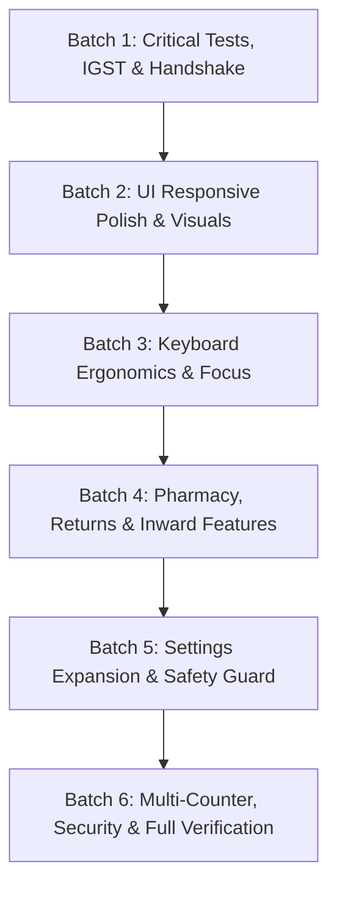

# LamSuite Billing — Phase 2: Implementation & Verification Plan

**Date:** 2026-10-13  
**Status:** Ready for User Review & Approval  
**Context:** Based on findings from [AUDIT_REPORT_PHASE1.md](file:///Users/anshad/.gemini/antigravity/scratch/lamsuite-billing/AUDIT_REPORT_PHASE1.md).

---

## 1. Overview & Strategy

This plan organizes all fixes, feature additions, settings, UI polish, and test updates into **6 sequential, strictly ordered batches**. 

Each batch:
- Operates on a defined set of files and components (focusing on root-cause fixes in shared services/components).
- Preserves existing data and backward compatibility.
- Contains explicit automated tests (Unit, Integration, and Keyboard flow).
- Defines verifiable acceptance criteria.

---

## 2. Ordered Work Batches

### Batch 1: Critical Bugs, Protocol Handshake & Data Correctness
**Focus:** Fix broken tests, tool count discrepancies, inter-state IGST column presentation, and Section 34 invoice matching inspection.

| Task ID | Component / Area | Description | Dependencies | Automated Tests |
|---|---|---|---|---|
| **B1-01** | `mcp-server` | Synchronize tool registry counts in `inspector.test.ts` (37 tools) and `readOnlyMode.test.ts` (25 read, 12 write) following addition of Universal Data Exchange tools. | None | `npm test --prefix mcp-server` |
| **B1-02** | `frontend/src/pages/PosBillingPage.tsx` | Dynamically switch cart grid and summary tax headers from `CGST / SGST` to `IGST` when billing an inter-state customer (`isInterState = true`). | None | `vitest run src/lib/billing/billingCalculations.test.ts` & POS Cart tests |
| **B1-03** | `frontend/src/pages/CustomerDebitNotePage.tsx` | Add side-by-side original invoice details inspection drawer in Customer Debit Notes B2B reconciliation screen. | None | `vitest run src/lib/billing/customerDebitNoteService.test.ts` |
| **B1-04** | `backend/app/Http/Controllers/Api/` | Ensure backend `/api/admin/invoices` and `/api/admin/reports` compute and return inter-state IGST breakdown with 100% parity to desktop calculations. | None | `backend/vendor/bin/phpunit` |

---

### Batch 2: UI Responsive Polish, Layouts & Visual Consistency
**Focus:** Fix layout clipping at 1366px, long medicine names in grids, and visual hierarchy across Admin Panel and Desktop screens.

| Task ID | Component / Area | Description | Dependencies | Automated Tests |
|---|---|---|---|---|
| **B2-01** | `frontend/src/pages/StaffLoginPage.tsx` | Fix 1366px viewport clipping by adding responsive scroll container and compact operator badges for >8 staff members. | None | Visual verification at 1366px & 1920px |
| **B2-02** | `frontend/src/pages/PosBillingPage.tsx` | Handle long medicine and salt names in cart table cells with two-line layout (Brand Name + Strength/Generic) and hover tooltip. | B1-02 | Visual inspection & POS grid test |
| **B2-03** | `frontend/src/pages/SettingsPage.tsx` | Add live preview pill of generated invoice sequences in Document Sequences settings tab. | None | Unit test on sequence formatter |
| **B2-04** | `admin-panel/src/pages/FeaturesPage.tsx` | Group feature and menu toggles into clean card sections (Sales & POS, Inventory & Stock, Finance & Reports, System Governance). | None | `npm run build --prefix admin-panel` |
| **B2-05** | `frontend/src/components/PrintPreviewModal.tsx` | Ensure thermal 80mm/58mm previews auto-scale comfortably on high-DPI (1920px+) viewports. | None | Print preview render test |

---

### Batch 3: Keyboard Ergonomics, Focus Recovery & Accessibility
**Focus:** Ensure seamless keyboard-only counter operation and proper focus restoration after modal closes.

| Task ID | Component / Area | Description | Dependencies | Automated Tests |
|---|---|---|---|---|
| **B3-01** | `frontend/src/pages/PosBillingPage.tsx` | Restore focus automatically to Product Search Bar (`F1`) after closing Print Preview modal via `Esc` or "Done". | B1-02 | Keyboard focus simulation test |
| **B3-02** | `frontend/src/pages/StaffLoginPage.tsx` | Make password change modal non-escapable and clear temporary tokens on cancellation to avoid half-authenticated states. | B2-01 | Auth service tests |
| **B3-03** | `frontend/src/lib/masters/partiesStore.ts` | Normalize customer phone queries by stripping spaces (`98765 43210` $\to$ `9876543210`) so phone searches match reliably. | None | `vitest run src/lib/masters/partiesStore.test.ts` |
| **B3-04** | `frontend/src/components/RoundOffModal.tsx` | Display real-time dynamic round-off adjustment delta pill (`-₹0.45`) as the cashier types in custom payable amount. | None | UI component test |

---

### Batch 4: Missing Business & Statutory Features
**Focus:** Pharmacy Schedule H alerts, quarantine stock routing on returns, and inward purchase freight/round-off auto-balancing.

| Task ID | Component / Area | Description | Dependencies | Automated Tests |
|---|---|---|---|---|
| **B4-01** | `frontend/src/lib/billing/salesReturnService.ts` & `SalesReturnPage.tsx` | Add "Quarantine Shelf" stock routing option for damaged/expired customer returns to prevent accidental re-sale at POS. | None | `vitest run src/lib/billing/salesReturnService.test.ts` |
| **B4-02** | `frontend/src/components/purchases/PurchaseEntryForm.tsx` | Add one-click "Auto-balance to Round-Off / Freight" button when inward purchase vendor totals differ by $\le ₹2.00$. | None | Purchase calculation test |
| **B4-03** | `frontend/src/reports/pharmacy/` & `PosBillingPage.tsx` | Add Schedule H/H1 amber badge alerting when doctor medical council registration number is missing. | None | Pharmacy report tests |
| **B4-04** | `frontend/src/lib/data-exchange/engine/importers/itemsImporter.ts` | Auto-sanitize HSN codes during CSV import by stripping dots (`3004.90.99` $\to$ `30049099`). | None | Data exchange importer test |

---

### Batch 5: Configurable Settings Expansion & Pre-Reset Safety
**Focus:** Expose all newly identified operational settings in Settings Page and add automated safety backup before database reset.

| Task ID | Component / Area | Description | Dependencies | Automated Tests |
|---|---|---|---|---|
| **B5-01** | `frontend/src/lib/settings/companySettingsService.ts` | Add new settings fields: `enforceDoctorOnScheduleH`, `autoBalanceToleranceLimit`, `quarantineLocationDefault`, `continuousRollPerforationRuler`, `forceBackupBeforeReset`. | None | Settings service test |
| **B5-02** | `frontend/src/pages/SettingsPage.tsx` | Render UI controls for the new settings in Billing, Inventory, Printing, and Security tabs with sensible defaults. | B5-01 | Settings UI load/save test |
| **B5-03** | `frontend/src/pages/SettingsPage.tsx` | In Danger Zone / Reset, automatically trigger and download encrypted JSON backup package before executing SQLite purge. | B5-01 | Backup & reset test |
| **B5-04** | `frontend/src/pages/InterStoreTransferPage.tsx` | Add 12-digit Indian e-Way Bill format validation regex when entering transport details. | None | Transfer validation test |

---

### Batch 6: Performance, Security, Multi-Counter & Final Verification
**Focus:** Device revocation push invalidation, overdue shift alerts, end-to-end reconciliation, and test suite execution.

| Task ID | Component / Area | Description | Dependencies | Automated Tests |
|---|---|---|---|---|
| **B6-01** | `frontend/src/pages/CounterStatusPage.tsx` | Highlight active shifts running >24 hours with an amber `"Overdue Shift"` indicator. | None | Shift status test |
| **B6-02** | `admin-panel/src/pages/DevicesPage.tsx` & `backend` | Broadcast token invalidation when a device terminal is revoked in Cloud Admin. | None | Device revocation integration test |
| **B6-03** | `admin-panel/src/pages/AuditLogsPage.tsx` | Convert free-text entity filter into selectable dropdown of entity types. | None | Audit log filter test |
| **B6-04** | Entire Platform | Run complete test suites across frontend, backend, admin-panel, and mcp-server. Verify zero console errors and 100% test pass rate. | All Batches | Vitest (frontend + mcp), PHPUnit (backend) |

---

## 3. Dependency Graph

---

> [!IMPORTANT]
> **Phase 2 Plan Complete.**  
> In accordance with instructions, execution will begin upon your approval. Please confirm to proceed with **PHASE 3: Fix and build** (starting with Batch 1).
