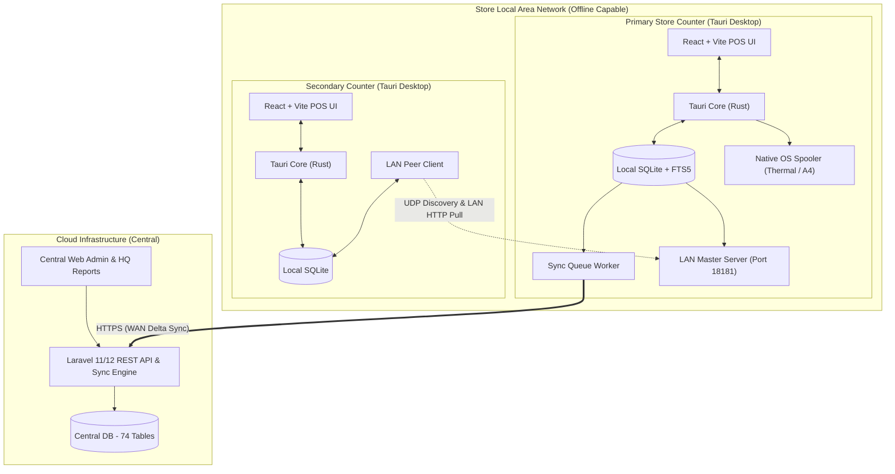

# 02. Comprehensive Architecture & Implementation Plan

## 1. System Architecture



---

## 2. PWA-to-Desktop Mapping (Resolved)

Every browser-only constraint is resolved natively:

| Current PWA / Browser | New Desktop Implementation | Technical Details |
|---|---|---|
| **WebAuthn Biometric** | **Fast PIN + Windows Hello** | Quick 4-digit Cashier PIN with optional Windows Hello biometric via native OS bridge; fallback to PIN on Windows 7/8. |
| **JSPrintManager WebSocket** | **Native Direct OS Printing** | Raw ESC/POS thermal printing to Windows Spooler / CUPS via Rust native printer plugin or direct Win32 spooler API. |
| **Browser "Save as PDF"** | **Native Headless PDF** | Native vector PDF rendering written directly to disk without opening print dialogs. |
| **Service Worker & PWA Banner** | **Tauri Updater / Squirrel** | Built-in cryptographic updater (`tauri-plugin-updater`) for seamless background updates. |
| **Browser Notifications** | **Native OS Notifications** | Desktop toast notifications for expiry alerts, low stock, and sync statuses. |
| **Separate Browser Windows** | **Tauri Multi-Window** | Native OS multi-window support for POS, Invoice Preview, Settings, and GST Calculator. |
| **Browser LAN Discovery** | **Native UDP / mDNS** | Multicast UDP broadcast on port 18181 for zero-config terminal auto-discovery. |
| **IndexedDB / 5MB LS Hack** | **Local SQLite with WAL & FTS5** | Unrestricted ACID SQLite database with Full-Text Search across 100,000 items in $< 10\text{ms}$. |
| **Manual / Browser Backup** | **Automated SQLite Snapshot** | Scheduled background backup creating timestamped, encrypted SQLite snapshots. |
| **Wi-Fi Strength Indicator** | **Native OS Network Status** | Live network adapter listener detecting WAN/LAN state changes instantly. |

---

## 3. Local SQLite Schema (Desktop Offline Engine)

The local SQLite database mirrors the essential operational subset of the central schema:

```sql
-- 1. Invoices & Sales
CREATE TABLE invoices (
    id TEXT PRIMARY KEY,
    module_key TEXT NOT NULL DEFAULT 'invoice',
    invoice_number TEXT NOT NULL UNIQUE,
    invoice_date TEXT NOT NULL,
    due_date TEXT,
    customer_id TEXT,
    customer_name TEXT,
    customer_gstin TEXT,
    place_of_supply TEXT,
    subtotal REAL NOT NULL DEFAULT 0,
    discount_total REAL NOT NULL DEFAULT 0,
    tax_total REAL NOT NULL DEFAULT 0,
    round_off REAL NOT NULL DEFAULT 0,
    grand_total REAL NOT NULL DEFAULT 0,
    paid_amount REAL NOT NULL DEFAULT 0,
    payment_mode TEXT NOT NULL DEFAULT 'cash',
    status TEXT NOT NULL DEFAULT 'issued',
    patient_id TEXT,
    patient_name TEXT,
    doctor_id TEXT,
    doctor_name TEXT,
    prescription_no TEXT,
    sync_state TEXT NOT NULL DEFAULT 'pending',
    external_id TEXT UNIQUE NOT NULL,
    created_at INTEGER NOT NULL,
    updated_at INTEGER NOT NULL
);

CREATE TABLE invoice_items (
    id TEXT PRIMARY KEY,
    invoice_id TEXT NOT NULL REFERENCES invoices(id) ON DELETE CASCADE,
    product_id TEXT NOT NULL,
    product_name TEXT NOT NULL,
    hsn_code TEXT,
    batch_no TEXT,
    expiry_date TEXT,
    qty REAL NOT NULL,
    loose_qty REAL DEFAULT 0,
    units_per_pack INTEGER DEFAULT 1,
    unit_price REAL NOT NULL,
    mrp REAL,
    discount_percent REAL DEFAULT 0,
    discount_amount REAL DEFAULT 0,
    gst_percent REAL NOT NULL,
    cgst_amount REAL DEFAULT 0,
    sgst_amount REAL DEFAULT 0,
    igst_amount REAL DEFAULT 0,
    total_amount REAL NOT NULL
);

-- 2. Products & FTS Search
CREATE TABLE products (
    id TEXT PRIMARY KEY,
    barcode TEXT NOT NULL,
    name TEXT NOT NULL,
    print_name TEXT,
    generic_name TEXT,
    hsn_sac_code TEXT,
    category_id TEXT,
    brand_id TEXT,
    unit_id TEXT,
    mrp REAL NOT NULL,
    sel_rate REAL NOT NULL,
    ptr REAL,
    pts REAL,
    gst_percent REAL NOT NULL,
    units_per_pack INTEGER DEFAULT 1,
    rack_location TEXT,
    shelf_location TEXT,
    reorder_level REAL DEFAULT 0,
    current_stock REAL DEFAULT 0,
    is_active INTEGER DEFAULT 1,
    external_id TEXT UNIQUE
);

CREATE VIRTUAL TABLE products_fts USING fts5(
    name, print_name, generic_name, barcode, hsn_sac_code, content=products, content_rowid=rowid
);

-- 3. Batches
CREATE TABLE product_batches (
    id TEXT PRIMARY KEY,
    product_id TEXT NOT NULL REFERENCES products(id),
    batch_no TEXT NOT NULL,
    mfg_date TEXT,
    expiry_date TEXT NOT NULL,
    stock_qty REAL NOT NULL DEFAULT 0,
    mrp REAL,
    purchase_rate REAL,
    selling_rate REAL,
    rack_location TEXT,
    shelf_location TEXT
);

-- 4. Double-Entry Stock Ledger
CREATE TABLE stock_transactions (
    id TEXT PRIMARY KEY,
    product_id TEXT NOT NULL,
    batch_id TEXT,
    event_type TEXT NOT NULL, -- SALE, PURCHASE, RETURN, ADJUSTMENT, TRANSFER
    qty_delta REAL NOT NULL,
    unit_cost REAL,
    reference_type TEXT,
    reference_id TEXT,
    created_at INTEGER NOT NULL
);

-- 5. Outbound Sync Queue
CREATE TABLE sync_queue (
    id TEXT PRIMARY KEY,
    entity_type TEXT NOT NULL, -- invoice, product, customer, stock_event
    entity_id TEXT NOT NULL,
    action TEXT NOT NULL, -- create, update, delete
    payload_json TEXT NOT NULL,
    status TEXT NOT NULL DEFAULT 'pending', -- pending, in_progress, failed, synced
    retry_count INTEGER DEFAULT 0,
    last_error TEXT,
    created_at INTEGER NOT NULL
);
```

---

## 4. Native Printing Engine

1. **ESC/POS Thermal Driver:**
   - Raw binary ESC/POS formatting (bold headers, double-height font, tabular item formatting, graphic bitmap QR code printing, and full paper cut `GS V 0`).
   - Bypasses GDI/driver conversions for instantaneous print output.
2. **A4 / A5 Document Renderer:**
   - Clean HTML-to-print pipeline utilizing the operating system spooler directly.
   - Built-in multi-page sheet pagination ensuring tables break cleanly across pages with repeated header rows.

---

## 5. Security & Multi-Counter Permissions

- **Local Operator Session:** Fast PIN switch verifies against bcrypt/argon2 hashes stored in local SQLite.
- **Lockout Rule:** 5 failed attempts locks terminal for 15 minutes.
- **Audit Trail:** Every transaction records operator name, terminal UUID, and sequence number.
