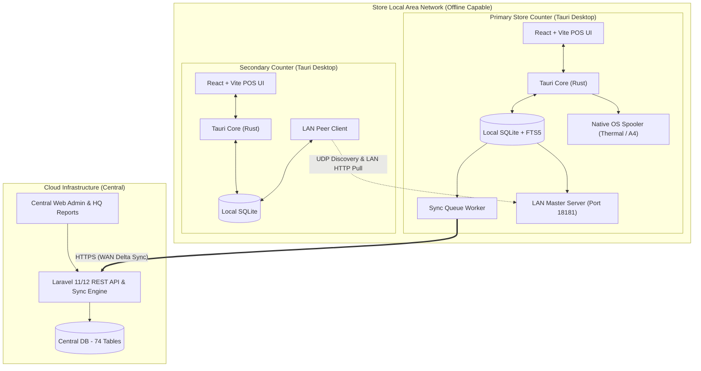
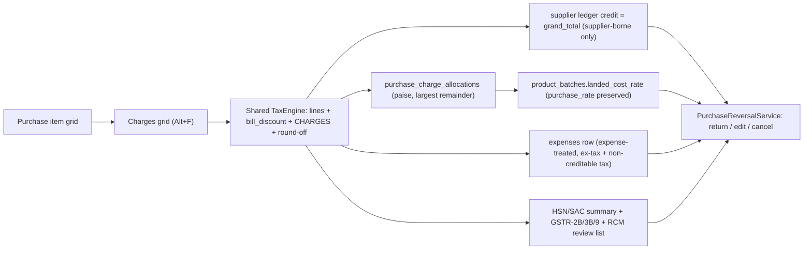

# 02. Comprehensive Architecture & Implementation Plan

## 1. System Architecture



---

## 2. PWA-to-Desktop Mapping (Resolved)

Every browser-only constraint is resolved natively:

| Current PWA / Browser | New Desktop Implementation | Technical Details |
|---|---|---|
| **WebAuthn Biometric** | **Fast PIN + Windows Hello** | Quick 4-digit Cashier PIN with optional Windows Hello biometric via native OS bridge; fallback to PIN on Windows 7/8. |
| **JSPrintManager WebSocket** | **Native Direct OS Printing** | Raw ESC/POS thermal printing to Windows Spooler / CUPS via Rust native printer plugin or direct Win32 spooler API. |
| **Browser "Save as PDF"** | **Native Headless PDF** | Native vector PDF rendering written directly to disk without opening print dialogs. |
| **Service Worker & PWA Banner** | **Tauri Updater / Squirrel** | Built-in cryptographic updater (`tauri-plugin-updater`) for seamless background updates. |
| **Browser Notifications** | **Native OS Notifications** | Desktop toast notifications for expiry alerts, low stock, and sync statuses. |
| **Separate Browser Windows** | **Tauri Multi-Window** | Native OS multi-window support for POS, Invoice Preview, Settings, and GST Calculator. |
| **Browser LAN Discovery** | **Native UDP / mDNS** | Multicast UDP broadcast on port 18181 for zero-config terminal auto-discovery. |
| **IndexedDB / 5MB LS Hack** | **Local SQLite with WAL & FTS5** | Unrestricted ACID SQLite database with Full-Text Search across 100,000 items in $< 10\text{ms}$. |
| **Manual / Browser Backup** | **Automated SQLite Snapshot** | Scheduled background backup creating timestamped, encrypted SQLite snapshots. |
| **Wi-Fi Strength Indicator** | **Native OS Network Status** | Live network adapter listener detecting WAN/LAN state changes instantly. |

---

## 3. Local SQLite Schema (Desktop Offline Engine)

The local SQLite database mirrors the essential operational subset of the central schema:

```sql
-- 1. Invoices & Sales
CREATE TABLE invoices (
    id TEXT PRIMARY KEY,
    module_key TEXT NOT NULL DEFAULT 'invoice',
    invoice_number TEXT NOT NULL UNIQUE,
    invoice_date TEXT NOT NULL,
    due_date TEXT,
    customer_id TEXT,
    customer_name TEXT,
    customer_gstin TEXT,
    place_of_supply TEXT,
    subtotal REAL NOT NULL DEFAULT 0,
    discount_total REAL NOT NULL DEFAULT 0,
    tax_total REAL NOT NULL DEFAULT 0,
    round_off REAL NOT NULL DEFAULT 0,
    grand_total REAL NOT NULL DEFAULT 0,
    paid_amount REAL NOT NULL DEFAULT 0,
    payment_mode TEXT NOT NULL DEFAULT 'cash',
    status TEXT NOT NULL DEFAULT 'issued',
    patient_id TEXT,
    patient_name TEXT,
    doctor_id TEXT,
    doctor_name TEXT,
    prescription_no TEXT,
    sync_state TEXT NOT NULL DEFAULT 'pending',
    external_id TEXT UNIQUE NOT NULL,
    created_at INTEGER NOT NULL,
    updated_at INTEGER NOT NULL
);

CREATE TABLE invoice_items (
    id TEXT PRIMARY KEY,
    invoice_id TEXT NOT NULL REFERENCES invoices(id) ON DELETE CASCADE,
    product_id TEXT NOT NULL,
    product_name TEXT NOT NULL,
    hsn_code TEXT,
    batch_no TEXT,
    expiry_date TEXT,
    qty REAL NOT NULL,
    loose_qty REAL DEFAULT 0,
    units_per_pack INTEGER DEFAULT 1,
    unit_price REAL NOT NULL,
    mrp REAL,
    discount_percent REAL DEFAULT 0,
    discount_amount REAL DEFAULT 0,
    gst_percent REAL NOT NULL,
    cgst_amount REAL DEFAULT 0,
    sgst_amount REAL DEFAULT 0,
    igst_amount REAL DEFAULT 0,
    total_amount REAL NOT NULL
);

-- 2. Products & FTS Search
CREATE TABLE products (
    id TEXT PRIMARY KEY,
    barcode TEXT NOT NULL,
    name TEXT NOT NULL,
    print_name TEXT,
    generic_name TEXT,
    hsn_sac_code TEXT,
    category_id TEXT,
    brand_id TEXT,
    unit_id TEXT,
    mrp REAL NOT NULL,
    sel_rate REAL NOT NULL,
    ptr REAL,
    pts REAL,
    gst_percent REAL NOT NULL,
    units_per_pack INTEGER DEFAULT 1,
    rack_location TEXT,
    shelf_location TEXT,
    reorder_level REAL DEFAULT 0,
    current_stock REAL DEFAULT 0,
    is_active INTEGER DEFAULT 1,
    external_id TEXT UNIQUE
);

CREATE VIRTUAL TABLE products_fts USING fts5(
    name, print_name, generic_name, barcode, hsn_sac_code, content=products, content_rowid=rowid
);

-- 3. Batches
CREATE TABLE product_batches (
    id TEXT PRIMARY KEY,
    product_id TEXT NOT NULL REFERENCES products(id),
    batch_no TEXT NOT NULL,
    mfg_date TEXT,
    expiry_date TEXT NOT NULL,
    stock_qty REAL NOT NULL DEFAULT 0,
    mrp REAL,
    purchase_rate REAL,
    selling_rate REAL,
    rack_location TEXT,
    shelf_location TEXT
);

-- 4. Double-Entry Stock Ledger
CREATE TABLE stock_transactions (
    id TEXT PRIMARY KEY,
    product_id TEXT NOT NULL,
    batch_id TEXT,
    event_type TEXT NOT NULL, -- SALE, PURCHASE, RETURN, ADJUSTMENT, TRANSFER
    qty_delta REAL NOT NULL,
    unit_cost REAL,
    reference_type TEXT,
    reference_id TEXT,
    created_at INTEGER NOT NULL
);

-- 5. Outbound Sync Queue
CREATE TABLE sync_queue (
    id TEXT PRIMARY KEY,
    entity_type TEXT NOT NULL, -- invoice, product, customer, stock_event
    entity_id TEXT NOT NULL,
    action TEXT NOT NULL, -- create, update, delete
    payload_json TEXT NOT NULL,
    status TEXT NOT NULL DEFAULT 'pending', -- pending, in_progress, failed, synced
    retry_count INTEGER DEFAULT 0,
    last_error TEXT,
    created_at INTEGER NOT NULL
);
```

---

## 4. Native Printing Engine

1. **ESC/POS Thermal Driver:**
   - Raw binary ESC/POS formatting (bold headers, double-height font, tabular item formatting, graphic bitmap QR code printing, and full paper cut `GS V 0`).
   - Bypasses GDI/driver conversions for instantaneous print output.
2. **A4 / A5 Document Renderer:**
   - Clean HTML-to-print pipeline utilizing the operating system spooler directly.
   - Built-in multi-page sheet pagination ensuring tables break cleanly across pages with repeated header rows.

---

## 5. Security & Multi-Counter Permissions

- **Local Operator Session:** Fast PIN switch verifies against bcrypt/argon2 hashes stored in local SQLite.
- **Lockout Rule:** 5 failed attempts locks terminal for 15 minutes.
- **Audit Trail:** Every transaction records operator name, terminal UUID, and sequence number.

---

## 6. Supplier Bill Charges (CR-C, 2026-11-19)

### 6.1 Data flow



Charges are part of the **purchase aggregate** at every layer: one local transaction, one sync queue entry, one
server upsert, one reversal unit. There is deliberately no standalone `purchase_charge` entity type in the queue.

### 6.2 Central schema (Laravel)

```sql
-- 6.2.1 Charge lines on a purchase bill
CREATE TABLE purchase_charges (
  id BIGINT PK,
  store_id BIGINT NOT NULL,            -- R12 / R6: charges are store data
  purchase_id BIGINT NOT NULL,         -- -> purchases
  external_id VARCHAR NOT NULL,        -- till GUID; unique (store_id, external_id)
  seq INT NOT NULL,
  head_code VARCHAR(40) NOT NULL,      -- stable identity even after the head is deleted
  head_name VARCHAR(100) NOT NULL,     -- denormalised for registers, exports and audits
  note TEXT NULL,
  treatment ENUM('add_to_cost','expense') NOT NULL,
  spread_method ENUM('value','quantity','weight') NOT NULL,
  spread_basis_used ENUM('value','quantity','weight') NOT NULL, -- after weight->value fallback
  itc_eligibility ENUM('eligible','ineligible','blocked','partial') NOT NULL,
  is_rcm TINYINT(1) NOT NULL DEFAULT 0,
  paid_separately TINYINT(1) NOT NULL DEFAULT 0,
  in_payable TINYINT(1) NOT NULL DEFAULT 1, -- CR-C-11: stored with the line; backfilled from paid_separately
  paid_to_label VARCHAR(120) NULL,     -- transporter name; no party master required
  place_of_supply VARCHAR(40) NULL,    -- override for a locally paid transporter bill
  sac_code VARCHAR(20) NULL,
  amount DECIMAL(12,2) NOT NULL,       -- SIGNED: negatives are cash discount / round-off / TCS
  gst_percent DECIMAL(5,2) NOT NULL DEFAULT 0,
  taxable_amount DECIMAL(12,2) NOT NULL,
  cgst_amount DECIMAL(12,2) NOT NULL DEFAULT 0,
  sgst_amount DECIMAL(12,2) NOT NULL DEFAULT 0,
  igst_amount DECIMAL(12,2) NOT NULL DEFAULT 0,
  cess_amount DECIMAL(12,2) NOT NULL DEFAULT 0,
  total_amount DECIMAL(12,2) NOT NULL,
  allocated_amount DECIMAL(12,2) NOT NULL DEFAULT 0, -- == taxable_amount for add_to_cost, else 0
  source ENUM('manual','legacy_freight','return_reversal','import','ocr') NOT NULL DEFAULT 'manual',
  expense_id BIGINT NULL,              -- -> expenses, when expense-treated
  reversed_amount DECIMAL(12,2) NOT NULL DEFAULT 0,  -- what the live returns take back; re-derived, never incremented
  created_by BIGINT NULL,
  timestamps
  UNIQUE (store_id, external_id),
  INDEX (purchase_id), INDEX (store_id, head_code)
);

-- 6.2.2 Per-line allocation: what makes reversal and reconciliation provable
CREATE TABLE purchase_charge_allocations (
  id BIGINT PK,
  store_id BIGINT NOT NULL,
  purchase_charge_id BIGINT NOT NULL,
  purchase_item_id BIGINT NOT NULL,
  batch_id BIGINT NULL,
  basis_amount DECIMAL(14,4) NOT NULL, -- the line's share of value / units / weight
  basis_share DECIMAL(9,6) NOT NULL,   -- fraction of the whole basis
  allocated_amount DECIMAL(12,2) NOT NULL,
  is_remainder_paisa TINYINT(1) NOT NULL DEFAULT 0,
  UNIQUE (purchase_charge_id, purchase_item_id)
);
```

Alterations: `purchase_items` gains `gross_weight_kg DECIMAL(12,3) NULL`, `charge_allocation DECIMAL(12,2) DEFAULT 0`,
`landed_unit_cost DECIMAL(12,4) NULL`, `original_purchase_item_id BIGINT NULL` (the return link `PUR-015` needs);
`product_batches` gains `landed_cost_rate DECIMAL(12,4) NULL` while `purchase_rate` stays exactly as the supplier
billed it; `expenses` gains `purchase_id`, `purchase_charge_id`, `gst_percent`, `cgst/sgst/igst_amount`,
`itc_eligibility`, `paid_separately`. `master_lookups` gains rows of `type = 'charge_head'` with **`store_id NOT
NULL`** and `config` JSON `{default_treatment, default_spread_method, default_itc_eligibility, allowed_sign,
sac_code, seeded}`.

### 6.3 Till storage

Local persistence is the JSON `kv_store` abstraction, so a new logical table costs a declared schema entry plus
service code — no `ALTER` risk. Version **9** of `sqliteStorage.MIGRATIONS` declares `purchase_charges` and
`purchase_charge_allocations` (mirroring §6.2 field-for-field) and finally declares the `freight_charges`,
`bill_discount_type`, `bill_discount` columns on `purchase_documents` that `purchaseService` has been writing
against since v2.0.41 but never declared. Version **11** adds `purchase_charges.in_payable` and backfills it from
the rule the existing rows were priced under — `paid_separately` meant outside the payable — so a store that turns
`separately_paid_in_payable` on afterwards cannot restate a bill that already printed.

### 6.4 Engine contract (both tiers, identical arithmetic)

`calculateDocumentTaxes({ ..., charges: [] })` gains a stage evaluated **after** bill-discount allocation and
**before** round-off. Per charge, in integer paisa:

1. `taxable = round_half_up(amount)` — sign preserved; `gst = round_half_up(|taxable| * rate / 100)` re-signed.
2. intra-state → `cgst = round_half_up(gst/2)`, `sgst = gst - cgst`; inter-state → `igst = gst`. Decided by the
   **supplier's** place of supply (GSTIN prefix first, then the explicit field), never by a hard-coded state.
3. `net_before_round = Σ lines + Σ charge taxable + Σ charge tax` **over the charges that ride on the supplier's
   bill** (`in_payable`). A charge billed by the supplier is always inside it; a `paid_separately` charge is inside it
   only when the store's `separately_paid_in_payable` policy says so, and the answer the document priced with is
   stored on the row (CR-C-11). Charges left outside are reported only in the `separate_charge_*` totals and never
   enter `net_before_round` or `grand_total` (CR-C D4). Round-off then applies
   exactly as today, so it is taken off the charge-inclusive total.
4. Allocation: `quotient = floor(basis_share * |spreadable| in paise)`, remainder paisa distributed largest-remainder
   first, ties by first line in grid order; `Σ allocations == taxable + non-creditable tax` exactly, with the sign
   applied afterwards. A charge whose tax cannot be claimed back carries that tax into cost with it, which is what
   keeps the identity closed for every eligibility combination. For a creditable charge the spreadable amount is
   simply the taxable amount. A degenerate basis (every line worth zero) places the whole amount on the first line
   in grid order rather than dropping paisa.
5. Output adds `charge_taxable_total`, `charge_tax_total`, `charge_total`, `separate_charge_taxable_total`,
   `separate_charge_tax_total`, `separate_charge_total`, `landed_cost_addition`, `expense_charge_total`,
   `creditable_input_tax_total`, `non_creditable_tax_total`, `reconciliation_identity_delta`, `charges[]` (each with
   `allocations[]`) and per line `charge_allocation`, `landed_amount`, `landed_unit_cost`; charge SAC rows are
   appended to `hsn_summary[]` and never blended into a goods row. `taxable_subtotal` stays goods-only in both
   treatments.

Golden vectors `TC11`–`TC22` in `specs/gst_tax_test_vectors.json` pin all of the above for both engines; `TC01`–`TC10`
must not move. `TC21`/`TC22` price the same document — goods 1,000 at 12% plus a 200 freight at 12% and a 50
insurance at 5%, both `paid_separately` — under each policy: 1,120.00 payable with the switch off, 1,396.50 with it
on, the 276.50 difference being exactly the separately-paid money, while landed cost (200.00, unit 120.00), the
expense posting (50.00) and creditable ITC (146.50) stay identical and `reconciliation_identity_delta` stays 0.

### 6.5 Reversal model

`PurchaseReversalService` (backend) and the till's edit/cancel path share one rule set:

| Event | Charges | Stock cost | Supplier payable | Tax | Expense |
|---|---|---|---|---|---|
| Return (proportional) | `−(allocation of returned item × returned units / line units)` per charge | landed cost reduced by the **add-to-cost** reversals alone | debited with goods + charge share | input tax reduced | reduced for expense-treated |
| Return (sunk) | none | none | goods only | goods tax only | none |
| Edit | reverse **all** old postings, re-post from the new payload as one transaction | re-derived | re-credited | re-posted | replaced |
| Cancel | full reversal, `reversed_amount == amount` | restored | fully debited | fully reversed | expense reversed |

Every path is idempotent on `external_id`, so a retried sync never double-reverses. A reversal line carries the
original charge row's stored `in_payable` into the engine, so a debit note nets against the payable or against the
separate-payment block exactly where the bill it returns was billed — even if the store changed the switch since.

### 6.6 Reconciliation identity (the release gate)

```
Σ goods taxable + Σ add_to_cost allocations + Σ expense postings (incl. non-creditable tax)
                + Σ creditable input tax (goods and charges)
    = (grand_total − round_off) + Σ charge totals left outside the payable

grand_total = supplier ledger credit
            = Σ line taxable + Σ line tax + Σ charge totals billed into the payable + round_off
```

Both "membership" terms read `purchase_charges.in_payable`, the answer the bill was priced with — not the policy of
the day (CR-C-11). A store switching `separately_paid_in_payable` moves a charge from one term to the other and the
identity still closes to `0.00`, which is what `TC21`/`TC22` pin.

`grand_total − round_off` is `net_before_round`: round-off is a cash-handling adjustment on the payable, not value
that lands in stock, expense or tax, so the identity closes against it and `reconciliation_identity_delta` is exactly
`0.00` for every document, including one with a non-zero round-off.

**Worked example** — goods ₹10,000 @12%, freight ₹200 @18%, packing ₹100 @18% → `grand_total ₹11,554`,
`input tax ₹1,254` in both treatments:

| Treatment | Stock cost | Expense register | Charge tax to ITC | Payable | Identity |
|---|---|---|---|---|---|
| `add_to_cost` | 10,300 | 0 | 54 (+1,200 goods) | 11,554 | 10,000 + 300 + 0 + 1,254 = 11,554 ✓ |
| `expense` | 10,000 | 300 | 54 (+1,200 goods) | 11,554 | 10,000 + 0 + 300 + 1,254 = 11,554 ✓ |

Vectors `TC11`–`TC22` in `specs/gst_tax_test_vectors.json` pin both rows, plus inter-state, remainder paisa with
a first-line tie, weight and weight-fallback, free units absorbing a quantity-basis share, negative charge with
blocked ITC, round-off closure over a capitalised charge, a separately-paid RCM transporter bill, and the same
separately-paid document priced under each `separately_paid_in_payable` policy.

### 6.7 Non-goals of this plan
No transporter party master, no accounts/journal layer behind the expense register, no 3-way PO/GRN/invoice
matching, no GSP/e-invoice or RCM return filing, no TDS/TDS certificate tracking.
