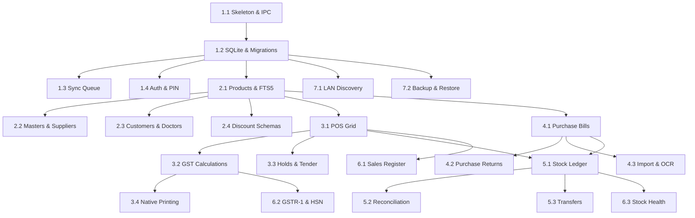

# 03. Implementation Tasks & Test Plan

All tasks are small, ordered, independently testable, and trace directly to requirement IDs.

---

## Phase 1: Foundation (Local DB, Project Skeleton, Sync Engine & Auth)

### Task 1.1: Project Skeleton & Desktop IPC Harness
- **Scope:** Initialize Tauri workspace (`/frontend`), configure React 19 + Vite + Tailwind + TypeScript, and set up unified IPC bridge (`IpcBridge`).
- **Req IDs:** `NFR-OS-01`, `NFR-PERF-01`
- **Verification / Test:**
  - Automated Vitest test verifying mock IPC calls.
  - Desktop app boots to dashboard window in $< 1\text{s}$.

### Task 1.2: Local SQLite Database & Migration Engine
- **Scope:** Implement Rust / SQLite schema initialization (`invoices`, `products`, `product_batches`, `stock_transactions`, `sync_queue`).
- **Req IDs:** `SYNC-001`, `NFR-DATA-01`
- **Verification / Test:**
  - Unit tests verifying WAL mode pragmas, schema migration execution, and transaction rollback on error.

### Task 1.3: Background Sync Queue & Idempotent HTTP Client
- **Scope:** Build local `sync_queue` table manager with exponential backoff and dispatch worker calling `/api/sync/*`.
- **Req IDs:** `SYNC-002`, `SYNC-003`
- **Verification / Test:**
  - Integration test simulating network outage, queuing 10 invoices, reconnecting, and verifying zero duplicate rows ingested by backend.

### Task 1.4: Operator PIN Authentication & Session Guard
- **Scope:** Fast 4-digit PIN authentication, operator switching, and idle lock listener.
- **Req IDs:** `SEC-001`, `SEC-003`
- **Verification / Test:**
  - Test verifying PIN verification latency $< 20\text{ms}$ and auto-lock after configured timeout.

---

## Phase 2: Master Data

### Task 2.1: Products & Batches SQLite Store with FTS5
- **Scope:** Product catalog CRUD with multiple barcodes, HSN, pricing tiers, and FTS5 search index.
- **Req IDs:** `MST-001`, `NFR-PERF-01`
- **Verification / Test:**
  - Benchmark test executing typeahead query across 50,000 synthetic items in $< 30\text{ms}$.

### Task 2.2: Categories, Brands, Units & Suppliers
- **Scope:** Master registries for product categorization and supplier directories.
- **Req IDs:** `MST-002`, `MST-003`
- **Verification / Test:**
  - Tests validating GSTIN regex format and unique category name constraints.

### Task 2.3: Customers, Doctors & Patients
- **Scope:** Customer directory with ledger balances, and clinical doctor/patient registries.
- **Req IDs:** `MST-004`, `MST-005`
- **Verification / Test:**
  - Unit test verifying phone formatting and quick-create customer during billing.

### Task 2.4: Discount Schemas Engine
- **Scope:** Rule evaluation engine applying Buy X Get Y and percentage rules.
- **Req IDs:** `MST-006`
- **Verification / Test:**
  - Unit test evaluating cart with promotional items and asserting correct automatic line discounts.

---

## Phase 3: Billing / POS & Native Printing

### Task 3.1: Keyboard-First POS Screen & Cart Engine
- **Scope:** High-throughput POS grid with hotkeys (`F1`-`F12`), barcode listener, and loose/pack rate calculator.
- **Req IDs:** `POS-001`, `POS-002`, `POS-007`
- **Verification / Test:**
  - UI integration test simulating rapid keyboard input (barcode scan, quantity entry, tender selection).

### Task 3.2: Multi-Tier GST & Auto Round-Off Calculation Engine
- **Scope:** Accurate GST inclusive/exclusive calculation, cess, and statutory whole-rupee rounding.
- **Req IDs:** `POS-003`, `POS-004`, `NFR-COMP-01`
- **Verification / Test:**
  - Comprehensive unit test suite with 50+ test cases covering all Indian GST tax brackets and edge cases.

### Task 3.3: Split Tender & Held Bills
- **Scope:** Multi-payment mode handling (Cash, UPI QR, Card, Credit) and local bill hold/recall.
- **Req IDs:** `POS-005`, `POS-006`
- **Verification / Test:**
  - Test holding 3 concurrent bills, recalling each in order, and completing checkout.

### Task 3.4: Native Printing & Dynamic Slip Formats
- **Scope:** Native OS printing engine delivering dynamic-height thermal slips (58mm/80mm) and A4 pharmacy tax invoices.
- **Req IDs:** `PRN-001`, `PRN-002`, `PRN-003`, `PRN-004`, `PRN-005`
- **Verification / Test:**
  - Integration test asserting valid ESC/POS byte sequence and successful headless PDF generation.

---

## Phase 4: Purchase Management

### Task 4.1: Purchase Bill Entry & Stock Inward
- **Scope:** Supplier purchase invoice entry with batch creation, manufacturing/expiry dates, and purchase pricing.
- **Req IDs:** `PUR-001`, `PUR-002`
- **Verification / Test:**
  - Test recording purchase bill with free goods and verifying credited stock units and updated average cost.

### Task 4.2: Purchase Returns & Purchase Requests
- **Scope:** Purchase returns posting debit notes, and low-stock reorder request generator.
- **Req IDs:** `PUR-003`, `PUR-004`
- **Verification / Test:**
  - Test generating low-stock request from items below minimum reorder level.

### Task 4.3: Tabular File Import & OCR/AI Ingestion
- **Scope:** Interactive Excel/CSV column mapping panel, and OCR/AI supplier invoice parsing.
- **Req IDs:** `PUR-005`, `PUR-006`
- **Verification / Test:**
  - Test uploading mock supplier PDF invoice and verifying extracted line items against catalog.

---

## Phase 5: Stock & Inventory Management

### Task 5.1: Double-Entry Stock Ledger
- **Scope:** Immutable stock transaction posting on all sales, purchases, and returns.
- **Req IDs:** `STK-001`, `STK-005`
- **Verification / Test:**
  - Audit test verifying that $\sum \text{stock\_transactions.qty\_delta}$ equals current on-hand stock for all batches.

### Task 5.2: Stock Adjustments & Physical Reconciliation
- **Scope:** Stock adjustment document entry and physical inventory audit sheet with discrepancy posting.
- **Req IDs:** `STK-002`, `STK-003`
- **Verification / Test:**
  - Test entering physical variance and posting adjustment to reconcile inventory.

### Task 5.3: Inter-Store Stock Transfers
- **Scope:** Two-phase dispatch and receive transfer workflow between store branches.
- **Req IDs:** `STK-004`
- **Verification / Test:**
  - Test dispatching transfer, checking `IN_TRANSIT` state, and completing receipt at destination.

---

## Phase 6: Reports & Statutory GST Compliance

### Task 6.1: Sales Register & Daily Collection Report
- **Scope:** Date-filtered sales registers with tender collection breakdown and export.
- **Req IDs:** `REP-001`, `REP-006`
- **Verification / Test:**
  - Test generating sales report for 1,000 bills and verifying tender totals match ledger.

### Task 6.2: GSTR-1 Compliance & HSN Summary
- **Scope:** Statutory GSTR-1 tables (B2B, B2C Large, B2C Small) and HSN/SAC aggregation.
- **Req IDs:** `REP-002`, `REP-003`
- **Verification / Test:**
  - Statutory accuracy test comparing report totals against manual GST computation spreadsheets.

### Task 6.3: Inventory Health & Customer Ledger Reports
- **Scope:** Near-expiry warnings (30/60/90 days), low stock alerts, and customer outstanding aging.
- **Req IDs:** `REP-004`, `REP-005`
- **Verification / Test:**
  - Test filtering items expiring in $< 60$ days and exporting result to Excel.

---

## Phase 7: LAN Sharing, Backup & Updates

### Task 7.1: In-Store UDP/mDNS LAN Discovery & HTTP Master Pull
- **Scope:** Embedded lightweight HTTP server on primary counter and UDP discovery client for secondary counters.
- **Req IDs:** `SYNC-005`
- **Verification / Test:**
  - Test two local terminal processes discovering each other on loopback and synchronizing master catalogs.

### Task 7.2: Scheduled Automated Backup & Restore
- **Scope:** Automated encrypted SQLite snapshot service and one-click database restore.
- **Req IDs:** `SYNC-006`
- **Verification / Test:**
  - Test executing backup, deleting local database, running restore, and validating table counts.

---

## Build Dependencies & Parallelism

