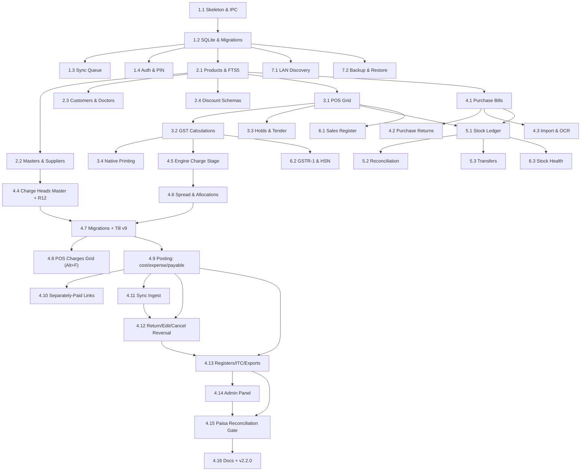

# 03. Implementation Tasks & Test Plan

All tasks are small, ordered, independently testable, and trace directly to requirement IDs.

---

## Phase 1: Foundation (Local DB, Project Skeleton, Sync Engine & Auth)

### Task 1.1: Project Skeleton & Desktop IPC Harness
- **Scope:** Initialize Tauri workspace (`/frontend`), configure React 19 + Vite + Tailwind + TypeScript, and set up unified IPC bridge (`IpcBridge`).
- **Req IDs:** `NFR-OS-01`, `NFR-PERF-01`
- **Verification / Test:**
  - Automated Vitest test verifying mock IPC calls.
  - Desktop app boots to dashboard window in $< 1\text{s}$.

### Task 1.2: Local SQLite Database & Migration Engine
- **Scope:** Implement Rust / SQLite schema initialization (`invoices`, `products`, `product_batches`, `stock_transactions`, `sync_queue`).
- **Req IDs:** `SYNC-001`, `NFR-DATA-01`
- **Verification / Test:**
  - Unit tests verifying WAL mode pragmas, schema migration execution, and transaction rollback on error.

### Task 1.3: Background Sync Queue & Idempotent HTTP Client
- **Scope:** Build local `sync_queue` table manager with exponential backoff and dispatch worker calling `/api/sync/*`.
- **Req IDs:** `SYNC-002`, `SYNC-003`
- **Verification / Test:**
  - Integration test simulating network outage, queuing 10 invoices, reconnecting, and verifying zero duplicate rows ingested by backend.

### Task 1.4: Operator PIN Authentication & Session Guard
- **Scope:** Fast 4-digit PIN authentication, operator switching, and idle lock listener.
- **Req IDs:** `SEC-001`, `SEC-003`
- **Verification / Test:**
  - Test verifying PIN verification latency $< 20\text{ms}$ and auto-lock after configured timeout.

---

## Phase 2: Master Data

### Task 2.1: Products & Batches SQLite Store with FTS5
- **Scope:** Product catalog CRUD with multiple barcodes, HSN, pricing tiers, and FTS5 search index.
- **Req IDs:** `MST-001`, `NFR-PERF-01`
- **Verification / Test:**
  - Benchmark test executing typeahead query across 50,000 synthetic items in $< 30\text{ms}$.

### Task 2.2: Categories, Brands, Units & Suppliers
- **Scope:** Master registries for product categorization and supplier directories.
- **Req IDs:** `MST-002`, `MST-003`
- **Verification / Test:**
  - Tests validating GSTIN regex format and unique category name constraints.

### Task 2.3: Customers, Doctors & Patients
- **Scope:** Customer directory with ledger balances, and clinical doctor/patient registries.
- **Req IDs:** `MST-004`, `MST-005`
- **Verification / Test:**
  - Unit test verifying phone formatting and quick-create customer during billing.

### Task 2.4: Discount Schemas Engine
- **Scope:** Rule evaluation engine applying Buy X Get Y and percentage rules.
- **Req IDs:** `MST-006`
- **Verification / Test:**
  - Unit test evaluating cart with promotional items and asserting correct automatic line discounts.

---

## Phase 3: Billing / POS & Native Printing

### Task 3.1: Keyboard-First POS Screen & Cart Engine
- **Scope:** High-throughput POS grid with hotkeys (`F1`-`F12`), barcode listener, and loose/pack rate calculator.
- **Req IDs:** `POS-001`, `POS-002`, `POS-007`
- **Verification / Test:**
  - UI integration test simulating rapid keyboard input (barcode scan, quantity entry, tender selection).

### Task 3.2: Multi-Tier GST & Auto Round-Off Calculation Engine
- **Scope:** Accurate GST inclusive/exclusive calculation, cess, and statutory whole-rupee rounding.
- **Req IDs:** `POS-003`, `POS-004`, `NFR-COMP-01`
- **Verification / Test:**
  - Comprehensive unit test suite with 50+ test cases covering all Indian GST tax brackets and edge cases.

### Task 3.3: Split Tender & Held Bills
- **Scope:** Multi-payment mode handling (Cash, UPI QR, Card, Credit) and local bill hold/recall.
- **Req IDs:** `POS-005`, `POS-006`
- **Verification / Test:**
  - Test holding 3 concurrent bills, recalling each in order, and completing checkout.

### Task 3.4: Native Printing & Dynamic Slip Formats
- **Scope:** Native OS printing engine delivering dynamic-height thermal slips (58mm/80mm) and A4 pharmacy tax invoices.
- **Req IDs:** `PRN-001`, `PRN-002`, `PRN-003`, `PRN-004`, `PRN-005`
- **Verification / Test:**
  - Integration test asserting valid ESC/POS byte sequence and successful headless PDF generation.

---

## Phase 4: Purchase Management

### Task 4.1: Purchase Bill Entry & Stock Inward
- **Scope:** Supplier purchase invoice entry with batch creation, manufacturing/expiry dates, and purchase pricing.
- **Req IDs:** `PUR-001`, `PUR-002`
- **Verification / Test:**
  - Test recording purchase bill with free goods and verifying credited stock units and updated average cost.

### Task 4.2: Purchase Returns & Purchase Requests
- **Scope:** Purchase returns posting debit notes, and low-stock reorder request generator.
- **Req IDs:** `PUR-003`, `PUR-004`
- **Verification / Test:**
  - Test generating low-stock request from items below minimum reorder level.

### Task 4.3: Tabular File Import & OCR/AI Ingestion
- **Scope:** Interactive Excel/CSV column mapping panel, and OCR/AI supplier invoice parsing.
- **Req IDs:** `PUR-005`, `PUR-006`
- **Verification / Test:**
  - Test uploading mock supplier PDF invoice and verifying extracted line items against catalog.

---

## Phase 4C: Supplier Bill Charges (CR-C, added 2026-11-19 — test-first)

> Every task below is written test-first: the named test is created and observed failing before the
> implementation that satisfies it. No task may be marked done on unit tests alone — the
> live-UI/live-API/live-DB evidence is recorded in the QA report.

### Task 4.4: Charge Heads Master, Seeding and Delete Guard
- **Scope:** `master_lookups.type='charge_head'` store-scoped rows, per-store default seeding (store creation + first read), reset-to-defaults, reassign-then-delete, admin CRUD, till pull-delta on the units branch, POS + admin panel tabs.
- **Req IDs:** `PUR-008`, `MST-008`, `R12`
- **Verification / Test:** `backend/tests/Feature/Constitution/ChargeHeadStoreScopeTest.php`, POS units-style dom tests for seeding/reset/guard.

### Task 4.5: Shared Tax Engine Charge Stage (PHP + TS parity)
- **Scope:** `charges[]` after bill-discount, before round-off; per-charge paisa GST split by supplier place of supply; negative charge support; charge SAC rows in `hsn_summary`; new totals keys; fix `PurchaseController` freight-after-engine and hard-coded `'XX'` place of supply.
- **Req IDs:** `PUR-001`, `PUR-009`, `POS-004` (regression), `NFR-COMP-01`
- **Verification / Test:** `TC11`–`TC22` vectors through `backend/tests/Unit/TaxEngineTest.php` and `frontend/src/lib/tax-engine/taxEngine.test.ts`; `TC01`–`TC10` unchanged; `backend/tests/Feature/PurchaseEntryParityTest.php` extended.

### Task 4.6: Spread Engine and Allocations
- **Scope:** basis by value / quantity (incl. free units) / weight with weight→value fallback and a surfaced notice; largest-remainder paisa distribution with grid-order tie-break; allocations persisted; signed spreading for negative charges. The `max_percent_of_goods` cap was carried by Task 4.14 and is enforced there, at posting rather than in the spread engine, so a bill over the cap never reaches the spreader.
- **Req IDs:** `PUR-010`, `PUR-014`
- **Verification / Test:** value/quantity/weight, remainder paisa, fallback notice and signed rows through the vector cases `TC13`–`TC20` in `backend/tests/Unit/TaxEngineTest.php` and `frontend/src/lib/tax-engine/taxEngine.test.ts`, plus `frontend/src/lib/purchases/chargesGrid.test.ts` for the till grid's basis choice and the legacy-freight ghost row.

### Task 4.7: Data Model Migrations & Till Schema v9
- **Scope:** `purchase_charges`, `purchase_charge_allocations`, altered `purchase_items` (+`gross_weight_kg`, `charge_allocation`, `landed_unit_cost`, `original_purchase_item_id`), `product_batches.landed_cost_rate`, `expenses` link + tax columns, legacy `freight_charges` → Freight charge data migration, local kv schema v9 incl. the previously-undeclared freight/bill-discount columns.
- **Req IDs:** `PUR-011`, `PUR-017`, `NFR-DATA-01`
- **Verification / Test:** `backend/tests/Feature/PurchaseChargeSchemaTest.php` (shape, store scoping, cross-store insert impossible, unique `(store_id, external_id)`, and legacy freight normalising into one Freight charge without rewriting history), `frontend/src/lib/db/sqliteStorage.test.ts` for the till migrations, `PurchaseChargePostingTest` / `SyncPurchaseChargesIngestTest` / `AccountingExportChargesTest` and `chargesGrid.test.ts` for the legacy ghost row keeping a pre-CR-C bill's totals where they were.

### Task 4.8: POS Charges Grid (keyboard-only) and Key Map
- **Scope:** pure keyboard engine in `frontend/src/lib/purchases/chargesGrid.ts` (row state, head preset defaults, spread basis choice, the legacy-freight ghost row) with the surface in `frontend/src/components/purchases/PurchaseChargesModal.tsx` (pattern: `lib/stock/stockAdjustmentKeyboard.ts`), modal-scope registration with the shortcut dispatcher (replacing the raw `window` keydown for this surface), `Alt+F` rebound from `focusFreight` to `toggleCharges`, head picker with type-to-filter, cycling selects, per-line weight column, totals-bar charge block, invoice-total check including supplier-borne charges only, post-summary checks, hint bar. Mounted on the purchase-entry screen (C1c, 2026-11-20): the freight scalar left the live path, the bar and the vendor check price the bill through `purchaseService.calculateDocumentTotals` with the resolved rows, the bill posts `charges[]`, and an edit or held draft opens its own rows — a pre-CR-C bill opens its `freight_charges` as one 0% Freight row (PUR-017). The one keyboard gap left here is that the screen still owns its `window` listener rather than registering with `shortcutDispatcher`.
- **Req IDs:** `PUR-007`, `PUR-014`, `PUR-016`, `PUR-017`
- **Verification / Test:** `frontend/src/components/purchases/PurchaseChargesModal.test.tsx` keyboard-only walkthrough (no pointer event fired), `frontend/src/lib/purchases/chargesGrid.test.ts` for the engine, `frontend/src/components/purchases/PurchaseEntryCharges.dom.test.tsx` for the same walkthrough on the bill itself (Alt+F, arrows and Space, Ctrl+Enter, the charge-inclusive payable and vendor check, the F12 charge block, `charges[]` in place of the freight scalar, both recall paths), `centralKeyMap.test.ts` conflict scan and modal-scope routing, `publishedKeyMap.test.ts` after regenerating `specs/keyboard-shortcuts.json` + `docs/KEYBOARD_SHORTCUTS.md`.

### Task 4.9: Posting — Landed Cost, Expense Register, Supplier Payable
- **Scope:** write allocations + `landed_cost_rate` while preserving `purchase_rate`; expense posting (ex-tax, non-creditable tax added) linked to the bill; payable covers supplier-borne charges in both treatments and excludes separately-paid; per-line effective unit cost includes allocation.
- **Req IDs:** `PUR-002`, `PUR-011`, `PUR-012`, `REP-005`
- **Verification / Test:** `backend/tests/Feature/PurchaseChargePostingTest.php`, `frontend/src/lib/purchases/chargePosting.test.ts`, extended `ExpenseManagementTest`.

### Task 4.10: Separately-Paid Charge Links
- **Scope:** `paid_separately` flag + `paid_to_label`, excluded from payable and invoice check, identical spread/expense rules, own block in the bill view and registers.
- **Req IDs:** `PUR-013`
- **Verification / Test:** `backend/tests/Feature/PurchaseChargeSeparatePaymentTest.php`.

### Task 4.11: Sync Ingest of Charges (aggregate payload)
- **Scope:** `charges[]` inside the existing purchase queue entry, idempotent child upsert/delete-recreate keyed by `(store_id, external_id)`, server recompute parity with the till, atomic replace, no orphan children.
- **Req IDs:** `PUR-017`, `SYNC-002`, `SYNC-007`
- **Verification / Test:** `backend/tests/Feature/SyncPurchaseChargesIngestTest.php` (create, retry, update, cancel), offline→online e2e in `tests/e2e`.

### Task 4.12: Return, Edit and Cancel Reversal
- **Scope:** `PurchaseReversalService` + till path; per-line proportional reversal (or sunk per policy); edit/cancel reverse-and-repost of charges, stock cost, payable and tax as one transaction; return-line → purchase-line linkage and backfill.
- **Req IDs:** `PUR-003`, `PUR-015`, `PUR-016`
- **Verification / Test:** `backend/tests/Feature/PurchaseChargeReversalTest.php` (part/full return, both policies, edit, cancel, double-push idempotency).

### Task 4.13: Registers, GST Summaries, Exports
- **Scope:** purchase register items-vs-charges split (POS + admin), net-new expense register report, margin on landed cost, ITC by charge eligibility, RCM charges flagged for review, Tally/Busy/CSV/gstExporter charge columns, purchase document printing. Purchase document printing landed on the till (C1d, 2026-11-20): `printingEngine` prints every charge head with its taxable, GST and total on the A4 purchase layout, the invoice layout a saved bill reprints from `PurchaseDetailsDrawer`, and all four dot-matrix widths — rows inside the payable print within the footings, rows outside it print as a marked memo below the grand total, a bill with no rows prints no block at all, and a pre-CR-C bill prints its freight scalar as the one 0% Freight row the register also reads, so the paper foots against the posted payable to the paisa (`PRN-007`).
- **Req IDs:** `REP-007`, `REP-008`, `REP-009`, `PUR-009`, `PRN-007`
- **Verification / Test:** `backend/tests/Feature/PurchaseChargeReportsTest.php`, `AccountingExportChargesTest` (Tally/Busy/CSV/gst-summary/day-book/expense-register/data-exchange columns; every voucher balances), `AccountingExportTest`, POS `reports/*.test.ts`, `frontend/src/lib/printing/purchaseChargesPrint.test.ts` (all three purchase layouts, the separately-paid marker, the payable footing, and a sales document left untouched), `frontend/src/components/purchases/PurchaseEntryPrint.dom.test.tsx` (the payload the entry screen hands the preview on `p`, for a charge keyed in the grid and for a pre-CR-C freight scalar).

### Task 4.14: Admin Panel — Heads, Policies, Charges Visibility
- **Scope:** charge heads master per store, charge policy section in Settings, every purchase's charges visible with filters (store, date, head, treatment, spread, ITC, RCM, paid-separately) and export, store identity column on cross-store rows, and the `separately_paid_in_payable` switch from Task 4.19 on the same screen. Landed 2026-11-20 (C2): the two keys the earlier drafts only declared — `purchase_charges.allow_negative_charges` and `purchase_charges.max_percent_of_goods` — are **enforced**, at `PurchaseChargeService::post()`, the single place both write paths (HTTP `POST` and the till's sync push) pass, inside the bill's transaction and before any row is written, so a refused bill leaves no header, rows, allocations or expense; a refusal names `charges.<n>.amount` (sign) or `charges` (cap) and quotes the allowance. `GET /admin/settings` now returns the policy block in the shapes the engine uses, so a store configured when booleans were strings shows its switches honestly. Heads are store-scoped rows (`type = charge_head`) with the seeded set restorable (`POST /admin/lookups/reset-charge-heads`) and a head a posted charge still references undeletable until those charges are moved (`DELETE /admin/lookups/{id}?reassign_to=`), which is the v2.1.1 unit lifecycle applied to charges. In the panel: a Charge Heads tab in Masters (per-head treatment/spread/ITC/sign/SAC editing, reset, reassign-before-delete), a Bill Charges tab in Transactions (`PurchaseChargesPanel` — filters, footing summary, store column under all-stores scope, CSV export) beside a new Charges column on the purchase register, and a "Supplier bill charges" card on the Settings general tab; a blank cap saves as `null`, and `null` or `0` is the engine's "no cap" (it returns for any cap `<= 0`).
- **Req IDs:** `PUR-008`, `PUR-016`, `CFG-003`, `R6`, `R12`
- **Verification / Test:** `backend/tests/Feature/AdminPurchaseChargesTest.php` (rows, filters, envelope summary, export, store scoping, permissions, the legacy scalar both stored and posted today) and `backend/tests/Feature/AdminSettingsTest.php` (policy persistence, read-model normalization, sign and cap refusals with their error keys); `admin-panel/src/pages/MastersPageChargeHeads.dom.test.tsx`, `admin-panel/src/components/transactions/PurchaseChargesPanel.dom.test.tsx`, `admin-panel/src/pages/SettingsPageChargePolicy.dom.test.tsx`. Live browser verification is Phase D. The policy was proven server-side earlier by `PurchaseChargePayablePolicyTest` and on the till by `companySettingsService.test.ts` / `payablePolicy.test.ts`.

### Task 4.15: Four-Way Paisa Reconciliation Gate
- **Scope:** automated proof that stock cost, supplier ledger, expense register and tax reconcile to the paisa for every posted, edited, returned and cancelled bill — including the ₹11,554 worked example in both treatments.
- **Req IDs:** all of `PUR-007`…`PUR-017`
- **Verification / Test:** `backend/tests/Feature/PurchaseChargeReconciliationTest.php`, run as a release gate.
- **Landed 2026-11-20 (Phase D):** eleven scenarios read every term of §6.6 out of the tables the postings
  wrote — spread rows, batch rates, `expenses`, charge columns — never from the request that filled them, and
  assert the delta as a string of paisa (`'0.00'`), not a tolerance. Covered: the worked example as
  add-to-cost (stock 300, register 0) and as expense (stock 0, register 300), a blocked head whose 36 of
  unclaimable GST is cost rather than input tax, a separately-paid charge read at both answers of the policy
  switch with each bill keeping its own, a part return, a full return, a cancellation, an edit that replaces
  its postings, and one store holding a bill in every state at once. `test_the_gate_fails_when_one_paisa_of_a_
  spread_row_does_not_exist` removes one paisa from an allocation row and expects `'0.01'`, so the gate cannot
  pass by being vacuous.
- **The gate found one defect:** a return of a bill that also carried an **expense-treated** charge valued the
  batch below the supplier's own rate — the reversal map derived a notional per-line share of the expensed
  charge (needed only to total its register credit) and fed it to the landed cost as well, so a ₹236 insurance
  line reversed onto the batch as ₹157.33 of negative cost. `PurchaseChargeReversalService::reversalMap()` and
  the till's `chargeTotals()` now keep the two maps apart: `charges` covers every charge line, `lines` only the
  ones that actually spread. Both sides proved test-first — the backend gate failed at `98.4267` against a
  supplier rate of `100`, and `chargeReversal.test.ts` fails the same paisa with the guard removed.
  `PUR-015` and `02-plan.md` §6.5 now state the rule the implementation follows.
- **Run as a gate 2026-11-20:** backend `OK (792 tests, 7992 assertions)`, till `979 passed (124 files)`,
  admin panel `21 passed (4 files)`. The owner half was then driven live — see the Phase D live-proof
  addendum in [traceability.md](traceability.md); the till's own screens were not.

### Task 4.16: Docs, Traceability and Release
- **Scope:** this file, module specs, constitution `R12`, `02-plan.md` §6, `specs/api/openapi.yaml`, `specs/data-exchange-templates.md`, `docs/KEYBOARD_SHORTCUTS.md`, `specs/traceability.md` statuses, `CHANGELOG.md`, v2.2.0 tag.
- **Req IDs:** traceability for every ID above
- **Verification / Test:** CI green on both suites + `publishedKeyMap` sync + constitution suites.
- **Landed 2026-11-20:** `CHANGELOG.md` carries the CR-C entry through item 13 (owner screens, the two
  enforced policy keys, the reconciliation gate and the live-proof record, including what was *not*
  driven live). Traceability statuses stay `In progress` until the tag: everything shipped is green and
  the panel half is seen live, but `PUR-007`, `SYNC-007` and `PRN-007` rest on their suites alone.
  **The v2.2.0 tag is not cut** — committing and tagging need an explicit go-ahead.

### CR-C-11 addendum — separately-paid charges in the payable

`PUR-013` decided that money handed to a transporter or insurer is never what the store owes the supplier. CR-C-11
makes that a per-store policy instead of a rule, and stores the answer on the charge row so switching it later
cannot restate a bill that already printed.

### Task 4.17: Payable Policy in Both Engines + Stored Membership
- **Scope:** `billing.purchase_charges.separately_paid_in_payable` (default `false`) read server-side and by the till; document-level engine input plus the per-charge `in_payable` override; `purchase_charges.in_payable` column (backend migration + till kv schema v11) backfilled `paid_separately → false`; posting stores the engine's answer; the sync payload keeps carrying `paid_separately`/`paid_to_label` and never `in_payable`, so the server derives membership from its own settings read.
- **Req IDs:** `PUR-009`, `PUR-011`, `PUR-013`, `PUR-016`, `CFG-003`, `SYNC-007`
- **Verification / Test:** `TC21`/`TC22` in `specs/gst_tax_test_vectors.json` through both harnesses; `backend/tests/Feature/PurchaseChargePayablePolicyTest.php`, `PurchaseChargeSchemaTest`, `frontend/src/lib/purchases/payablePolicy.test.ts`.

### Task 4.18: Reversals, Registers and Exports Read the Stored Answer
- **Scope:** a debit note inherits the original charge row's `in_payable` in both engines and both reversal builders; the purchase register, expense register, ITC/RCM summaries and Tally/Busy/CSV split on `in_payable` rather than re-deriving `!paid_separately`; `payment_mode`, expense attribution and GSTR-2B side stay keyed on `paid_separately`.
- **Req IDs:** `PUR-001`, `PUR-013`, `PUR-015`, `REP-005`, `REP-007`, `REP-008`, `REP-009`
- **Verification / Test:** `PurchaseChargePayablePolicyTest` (policy flip does not restate a printed bill; a note keyed after a flip still follows its bill), `chargeReversal.test.ts` + `payablePolicy.test.ts` returns block, `purchaseChargeRegister.test.ts`, `expenseRegister.test.ts`, `AccountingExportChargesTest`.

### Task 4.19: Till Settings, Posting and Grid Footer Parity
- **Scope:** `companySettingsService` reads the switch and the legacy `"1"`/`"true"` spellings, `chargePosting.ts` stores `in_payable`, the charges grid footer shows the payable, the charge total, the money left outside the bill and the qualifier when the policy bills separately-paid money in.
- **Req IDs:** `PUR-007`, `PUR-013`, `PUR-016`, `CFG-003`
- **Verification / Test:** `companySettingsService.test.ts`, `payablePolicy.test.ts`, `PurchaseChargesModal.test.tsx` footer block.

### Task 4.20: CR-C-11 Docs and Traceability
- **Scope:** `purchase-management.md` (PUR-001, PUR-009, PUR-013, PUR-015, PUR-016, identity), `reports-gst.md` (REP-005, REP-009), `auth-security-settings.md` (CFG-003), `02-plan.md` §6.2/6.3/6.4/6.5/6.6, `api/openapi.yaml`, `data-exchange-templates.md`, `traceability.md`, `README.md`, `CHANGELOG.md`.
- **Req IDs:** every ID above
- **Verification / Test:** spec/plan/contract reviewed against the shipped code; no requirement left claiming a separately-paid charge is *never* in the payable. The review also retired three over-claims: the contract's 422 list now names only rejections `PurchaseChargeService::resolveForStore()` actually raises, the two policy keys no code reads (`allow_negative_charges`, `max_percent_of_goods`) are marked declared-not-enforced and carried by Task 4.14, and legacy freight is documented as normalised at read rather than migrated. Task 4.14 (C2, 2026-11-20) later enforced both keys and the specs were re-delta'd to say so; the 422 list also gained the sign and cap refusals.

---

## Phase 5: Stock & Inventory Management

### Task 5.1: Double-Entry Stock Ledger
- **Scope:** Immutable stock transaction posting on all sales, purchases, and returns.
- **Req IDs:** `STK-001`, `STK-005`
- **Verification / Test:**
  - Audit test verifying that $\sum \text{stock\_transactions.qty\_delta}$ equals current on-hand stock for all batches.

### Task 5.2: Stock Adjustments & Physical Reconciliation
- **Scope:** Stock adjustment document entry and physical inventory audit sheet with discrepancy posting.
- **Req IDs:** `STK-002`, `STK-003`
- **Verification / Test:**
  - Test entering physical variance and posting adjustment to reconcile inventory.

### Task 5.3: Inter-Store Stock Transfers
- **Scope:** Two-phase dispatch and receive transfer workflow between store branches.
- **Req IDs:** `STK-004`
- **Verification / Test:**
  - Test dispatching transfer, checking `IN_TRANSIT` state, and completing receipt at destination.

---

## Phase 6: Reports & Statutory GST Compliance

### Task 6.1: Sales Register & Daily Collection Report
- **Scope:** Date-filtered sales registers with tender collection breakdown and export.
- **Req IDs:** `REP-001`, `REP-006`
- **Verification / Test:**
  - Test generating sales report for 1,000 bills and verifying tender totals match ledger.

### Task 6.2: GSTR-1 Compliance & HSN Summary
- **Scope:** Statutory GSTR-1 tables (B2B, B2C Large, B2C Small) and HSN/SAC aggregation.
- **Req IDs:** `REP-002`, `REP-003`
- **Verification / Test:**
  - Statutory accuracy test comparing report totals against manual GST computation spreadsheets.

### Task 6.3: Inventory Health & Customer Ledger Reports
- **Scope:** Near-expiry warnings (30/60/90 days), low stock alerts, and customer outstanding aging.
- **Req IDs:** `REP-004`, `REP-005`
- **Verification / Test:**
  - Test filtering items expiring in $< 60$ days and exporting result to Excel.

---

## Phase 7: LAN Sharing, Backup & Updates

### Task 7.1: In-Store UDP/mDNS LAN Discovery & HTTP Master Pull
- **Scope:** Embedded lightweight HTTP server on primary counter and UDP discovery client for secondary counters.
- **Req IDs:** `SYNC-005`
- **Verification / Test:**
  - Test two local terminal processes discovering each other on loopback and synchronizing master catalogs.

### Task 7.2: Scheduled Automated Backup & Restore
- **Scope:** Automated encrypted SQLite snapshot service and one-click database restore.
- **Req IDs:** `SYNC-006`
- **Verification / Test:**
  - Test executing backup, deleting local database, running restore, and validating table counts.

---

## Build Dependencies & Parallelism

