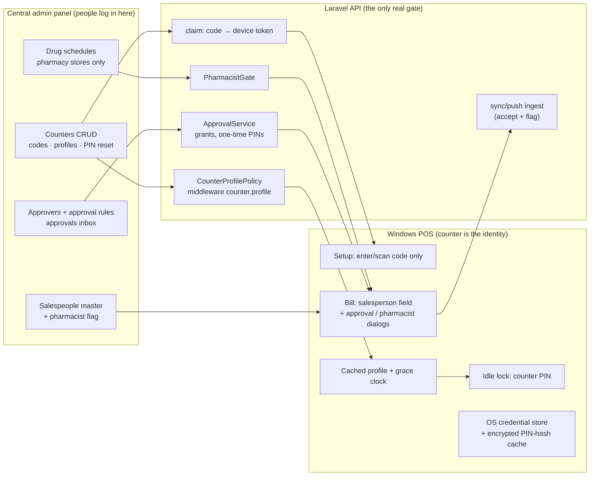

# Plan Delta — Counter-only POS, Salespeople, Approvals, Pharmacist rule

**Companion to** [impact-analysis.md](impact-analysis.md) and [spec-delta.md](spec-delta.md). This is the architecture half of the change request: what the system will look like, which tables/endpoints change, and how the new controls are actually enforced. Nothing here is implemented yet.

---

## 1. The architecture shift in one page



Three invariants replace today's model:

1. **The counter is the tenant principal.** A device token resolves to exactly one `(store, counter)` pair for its lifetime; every POS write is authorised as that counter.
2. **The profile is the only POS permission system.** People do not carry permissions into the till; roles remain purely an admin-panel concept.
3. **PINs at the till are evidence, not identity.** Counter PIN (unlock/shift), approver PIN (approval), salesperson PIN (owner-chosen low-risk approvals) and pharmacist PIN (restricted-drug confirmation) are four disjoint credential domains that authenticate *actions*.

## 2. Data model delta

### 2.1 `counters` — becomes an owner-owned entity

| Change | Detail |
|---|---|
| Status vocabulary | `unclaimed` (new default) → `active` → `locked` / `revoked`. `pending_approval` is **retired** (its rows migrate to `unclaimed` or `active`). |
| Add | `permission_profile` JSON (canonical, see §2.3), `permission_profile_version` ubigint (watermark the till compares), `idle_lock_minutes` int default 5, `grace_hours` int default 24, `unlock_pin_hash` nullable, `unlock_failed_attempts` int default 0, `unlock_locked_until` nullable, `current_device_id` FK→devices nullable, `last_salesperson_id/name`, `created_by`, `retired_at` |
| Rename | `manager_pin` → `unlock_pin_hash` (column is unpopulated everywhere; a rename migration is cheaper than leaving a misleading name) |
| Stop writing | `device_token` plaintext (hash-only), `pairing_code`/`pairing_expires_at` (retired with the approve-pairing flow), `role_profile` (superseded by `permission_profile`), `allowed_user_ids` (superseded by salesperson `allowed_counters` + profile), `visible_menus` (absorbed into profile), `counter_code` derivation from device name |
| Keep | `counter_code` unique per store, `device_uuid` (now written only by a claim), `last_synced_watermark`, `printer_profile`, `receipt_customization` (defaults moved into the profile copy at claim time, then editable per CR 1.1) |
| Index | Existing SQLite partial unique live-name index stays; add `unique (store_id, current_device_id)`-equivalent enforcement in the claim service (one active device per counter, `CNT-007`) |

### 2.2 `activation_keys` → per-counter, single-use codes

Add `counter_id` (FK, cascade), `consumed_at`, `consumed_device_uuid`, `label`, `ttl_hours`. Make `is_single_use` default true and enforce it in `isValid()` regardless of `max_devices`; default `expires_at` = now + 24 h when the owner does not choose. Keep `key_hash` (SHA-256) and `key_prefix`; drop the plaintext mirror into `stores.activation_key` ([ActivationKey.php:89-92](../../../backend/app/Models/ActivationKey.php#L89)) and **remove `stores.activation_key` / `activation_key_hash` columns** plus `require_device_approval` (approval-before-use is replaced by "the owner must issue a code"). `wipe_on_revocation` moves to the counter. New table `counter_activation_events` (or reuse `device_activation_attempts` + `counter_id`) to record code/IP/uuid failures for the lockout and the owner alert (`CNT-005`).

### 2.3 `permission_profile` — one canonical JSON, versioned

```json
{
  "modules": ["pos", "bills", "returns", "stock", "reports"],
  "screens": ["pos.billing", "pos.sales_return", "bills.past"],
  "cash_drawer": true,
  "discount": { "max_pct": 5, "approval_pct": 15, "max_amount": 500 },
  "price_override": { "allowed": false, "approval_pct": 10 },
  "sell_beyond_stock": { "allowed": false, "approval_required": true },
  "edits": { "allowed": true, "approval_required": true, "window_days": 1 },
  "cancellations": { "allowed": false, "approval_required": true },
  "returns": { "allowed": true, "approval_value_limit": 2000 },
  "purchase_entry": false,
  "stock_adjustments": { "allowed": false, "approval_limit_qty": 10 },
  "transfers": { "dispatch": false, "receive": false },
  "reports": ["sales", "gst"],
  "settings_editable": ["printer", "paper_size"],
  "printers": { "profile": "thermal_80", "paper_sizes": ["80mm"], "default": "thermal_80" },
  "payment_modes_allowed": ["cash", "upi", "card", "credit"],
  "salesperson": { "manage": false },
  "approval_methods": ["approver_pin", "one_time_pin", "salesperson_pin"]
}
```

Stored on `counters.permission_profile`; templates in a new store-scoped table `permission_profile_templates(id, store_id, name, profile_json, is_default, version, timestamps)`; "copy from counter" is a server-side duplicate + audit (`PRF-002`). Every save bumps `permission_profile_version` (`PRF-008` diffs via the existing tamper-evident `AuditLog`).

### 2.4 New table `salespeople` (decision 3, CR Part 4/5)

`id, store_id (NOT NULL), code, name, phone, photo_path, is_active, joined_on, left_on, allowed_counter_ids JSON, is_pharmacist, pharmacist_reg_no, reg_valid_from, reg_valid_until, incentive_rule JSON, target_amount, pin_hash nullable, pin_failed_attempts, pin_locked_until, pin_updated_at, is_approver(nullable: prefer `users`), archived_at, external_id, version, timestamps` with `unique (store_id, code)`, index `(store_id, is_active, archived_at)`, index `(store_id, is_pharmacist)`.

`incentive_rule` is an array of typed rules with effective dates so the later slabs/per-item release can extend it without a schema change:

```json
[ { "type": "pct_net_sales", "value": 1.5, "from": "2026-04-01", "to": null },
  { "type": "pct_by_group", "match": "Analgesics", "value": 2.0, "from": "2026-04-01" },
  { "type": "target", "period": "monthly", "amount": 500000, "from": "2026-04-01" } ]
```

A separate `incentive_rules` table is the alternative if the owner wants rule-level versioning (Q-note in [task-delta.md](task-delta.md) T4.3).

### 2.5 Documents gain the new columns

`invoices`: `salesperson_id`, `salesperson_name` (snapshot), `salesperson_pin_confirmed_action` (nullable), `pharmacist_salesperson_id`, `pharmacist_name`, `pharmacist_reg_no`, `pharmacist_confirmed_at`, `pharmacist_confirmation_source` (`online|offline_cached|queued`), plus the already-missing persistence of `prescription_no`, `doctor_id`, `patient_id` (POS-007 amendment). `invoice_items`: `salesperson_id`, `salesperson_name` (only populated when `SPR-007` is on). `user_id` stays for admin-panel-originated documents.

`counter_shifts`/local `cash_shifts` become **counter-keyed** (`counter_id` + optional `opened_by_salesperson_id`), dropping the `user_id` dependency; `counter_sessions` becomes `counter_activity` (last salesperson, last document, idle lock events).

`products`: `drug_schedule_id` (FK → schedule list, nullable) + `requires_prescription` boolean + `is_restricted` boolean (denormalised from the schedule row at save so a later list edit cannot silently change history). Schedule list itself: `master_lookups` with a new `type = 'drug_schedule'` **plus** pharmacy columns `is_restricted`, `requires_prescription`, `sort_order` — chosen over a new table so the existing lookup CRUD, sync delta and import plumbing is reused; store-scoped per the R11 precedent.

### 2.6 New table `pharmacist_confirmations`

`id, store_id, invoice_id nullable, invoice_external_id, counter_id, salesperson_id (pharmacist), pharmacist_name, reg_no, confirmed_at, verification_mode (online|offline_cached), restricted_item_ids JSON, pin_verified boolean, revoked_flag, created_at` — the register source (`PHR-005..006`, `PHR-009`) and the evidence row for offline confirmations that need review.

### 2.7 `invoice_approvals` → `approvals`

`Schema::rename` (rows preserved) plus: `counter_id`, `document_type` (`invoice|sales_return|purchase|stock_adjustment|transfer|payment`), `document_id` + `document_external_id` (offline-created docs), `action` widened to `edit|cancel|return|discount|price_override|stock_adjustment|sell_beyond_stock|large_refund|change_salesperson|purchase_entry`, `request_status` (`pending|granted|used|expired|revoked`), `method` (`approver_pin|one_time_pin|salesperson_pin|remote`), `approver_user_id`, `salesperson_id`, `rule_snapshot` JSON, `reason`, `expires_at`, `used_at`. `pin_hash`/`token_hash` stay hashed and hidden.

### 2.8 Local SQLite: schema version 9

One new `MIGRATIONS` entry in [sqliteStorage.ts:9+](../../../frontend/src/lib/db/sqliteStorage.ts#L9) (current last version is 8; numbering is non-contiguous, so use 9) creating: `counter_profile` (single row: profile JSON + version + fetched_at), `counter_meta` (counter id/code/name/store, claim time, grace deadline, unlock PIN hash + failure counters, idle minutes), `salespeople`, `approver_cache`, `drug_schedules`, `pharmacist_confirmations`, `approvals`, and `invoice_items` salesperson columns. `staff_users` stays only as the source for the one-time migration and is then retired from the login path; `counter_sessions`/`cash_shifts` re-keyed to counter.

## 3. API contract delta ([specs/api/openapi.yaml](../../api/openapi.yaml) — currently documents 0 counter endpoints)

**New**

| Endpoint | Purpose | IDs |
|---|---|---|
| `POST /api/admin/counters` `PUT /api/admin/counters/{id}` `DELETE …/request-delete` | counter CRUD + retire | CNT-001/002/009/010 |
| `POST /api/admin/counters/{id}/activation-codes` · `…/codes/{codeId}/reissue` · `…/codes/{codeId}/revoke` | issue/re-issue/revoke, returns the code **once** + QR payload | CNT-003/004/007 |
| `POST /api/counters/claim` (public, throttled) | `{ activation_code, device_uuid }` → `{ counter, store, device_token, profile, grace }` | CNT-005/006 |
| `POST /api/admin/counters/{id}/unlock-pin/reset` · `POST /api/admin/counters/{id}/unlock` | reset/unlock counter PIN | PRF-006 |
| `GET/PUT /api/admin/counters/{id}/profile` · `GET/POST/DELETE /api/admin/permission-profiles(templates)` · `POST …/copy-from-counter` | profile + templates | PRF-001/002 |
| `GET /api/counter/context` (device) | counter + profile + grace + cached credentials manifest, pulled at boot and on reconnect | PRF-004, CNT-011 |
| `POST /api/approvals` · `POST /api/approvals/{id}/grant` · `POST /api/approvals/{id}/redeem` · `GET /api/admin/approvals?status=pending` | request / remote approve / one-time use, plus inbox | APR-004/005/008 |
| `GET/POST/PUT/DELETE /api/admin/salespeople` (+ `/import` `/export` `/archive`) | master, spreadsheet, archive-not-delete | SPR-001/003/004 |
| `GET /api/salespeople/eligible?counter_id=` | the offline-cacheable list the type-ahead uses | SPR-010 |
| `POST /api/pharmacist/confirmations` (+ `GET /api/admin/pharmacists`, `/expiry-alerts`, `/exceptions`) | confirmation + admin views | PHR-002/007/010 |
| `GET /api/reports/salesperson` (+ `/incentive-statement`, `/target-achievement`) | Part 4 reporting | SPR-015 |

**Changed**: `POST /api/sync/push/invoices` accepts and persists approval + pharmacist evidence embedded in the invoice payload and **flags** violations instead of rejecting (Q1 (b)); every device-token write carries the profile gate; `/staff/offline-cache` is replaced by `/api/counter/context` + `GET /api/credentials/offline-cache` returning **only** approver/pharmacist/salesperson PIN hashes (never password hashes, never for a non-claimed counter).

**Retired**: `POST /devices/register-owner`, `POST /devices/register` (folded into `/counters/claim`), public `POST /counters/enroll`, `POST /counters/approve-pairing`, `GET /counters/enrollment-status/{device_uuid}`, public `POST /counters/{id}/status`, `POST /staff/login` + `POST /staff/logout` **for till sessions** (admin-panel login is Sanctum and stays), `AccountSwitcher`/staff-login client modules. Under Q3 (grace) these return `410` with an upgrade message rather than vanishing.

## 4. Enforcement design (the part that actually matters)

### 4.1 Profile gate

New `App\Services\Counter\CounterProfilePolicy` + middleware alias `counter.profile` registered next to `device.auth` ([bootstrap/app.php:32-39](../../../backend/bootstrap/app.php#L32)) and applied to **every** device-scoped route in [api.php:81-168](../../../backend/routes/api.php#L81). Each route declares an action key (`pos.save_bill`, `pos.discount`, `pos.price_override`, `invoice.edit`, `invoice.cancel`, `return.create`, `purchase.entry`, `stock.adjust`, `transfer.dispatch/receive`, `report.view`, `settings.change`, `salesperson.manage`, `cash_drawer`), resolved by a registry so a route with no declared key **fails closed**. Response is `403 { code: "counter_action_not_permitted", action }`. Tests call endpoints directly (no UI) per `PRF-003`.

For bulk sync ingest, the gate runs per payload row against the **profile version stamped on the document**, with the current version compared afterwards to produce exception rows (Q1).

### 4.2 Live propagation

`permission_profile_version` rides the existing heartbeat ([api.php:119-120](../../../backend/routes/api.php#L119)) and the SSE stream (`/sync/stream`) response; the till pulls `/api/counter/context` when the version differs. Offline counters keep the last saved profile and stamp it on documents; refresh on reconnect is explicit. Budget: ≤ 5 s for an attached counter (`PRF-004`).

### 4.3 Approvals

Server-side, at the point of write. Flow: the till computes which rules fire, opens the approval dialog, verifies (approver PIN / one-time PIN / salesperson PIN) or creates a `pending` remote request, then saves carrying `approval_id`. `InvoiceController::store`, `SyncController::upsertSingleInvoice`, `InvoiceController::cancel`, purchase and stock-adjustment paths call `ApprovalService::assertSettled($document, $actions)` — the control that is missing today. One-time PINs are bound to `(document_type, document, action)` and consumed atomically; `rule_snapshot` records the thresholds in force so a later rule edit cannot invalidate an old document.

### 4.4 Pharmacist gate

`RestrictedDrugResolver` scans cart lines against `products.is_restricted` (denormalised at sale time); the gate blocks save server-side when a restricted line exists without a `pharmacist_confirmation` (and, per `PHR-006`, when a prescription-requiring schedule lacks doctor/patient). Returns/cancellations re-run the resolver against the original document. Offline: verification against the cached hashes with local failure counters, confirmation queued with the bill, source stamped `offline_cached`; reconnect applies pharmacist revocations as exception flags rather than deleting evidence.

### 4.5 Credential domains

One `PinPolicy` service (min 6 digits, reject trivial/repeated/sequence values, lockout 5/15 min, admin-only reset, never returned by any API) shared by counter/approver/salesperson/pharmacist domains, each with its own hash column and its own lockout counters, and a per-store cross-domain uniqueness check so the same PIN is never reused across domains (`PHR-008`). Hashes ship to tills only through the counter-scoped offline-cache endpoint and land in the encrypted vault keyed per `(store, counter)`; device tokens move to the OS credential store (Q2), which also fixes the plaintext `devices.device_token` / `counters.device_token` columns (server keeps SHA-256 only).

## 5. Migration and rollback (`CNT-012`)

Ordered, dry-run-first, single artisan command per the `stores:scope-catalog` precedent ([specs/DATA_MIGRATION_GUIDE.md](../../DATA_MIGRATION_GUIDE.md)):

1. `counters:migrate-from-devices` — every active `devices` row becomes/relinks a `counter` (keep `device_name` as the counter name, `counter_code` derived once and frozen, `counter_sequences` left untouched so series continue, status → `active`, `current_device_id` set, `unclaimed` for orphans). Idempotent; writes a `counter-migration.json` manifest.
2. `counters:seed-profiles` — build `permission_profile` from the old `role_profile` booleans + `visible_menus` + store `enabled_menu_items`, defaults for everything new; templates from a "Standard till" preset.
3. `staff:convert-to-salespeople` — till-role users (`cashier|operator|pharmacist|manager|admin` with `pin_hash`) become `salespeople` rows (name/code/phone/PIN hash carried over verbatim so existing PINs keep working as *approver/pharmacist* credentials, not as logins); `manager|store_owner` additionally get `is_approver` on their `users` row.
4. `products:seed-drug-schedules --store=` — seed the schedule list + denormalised flags for pharmacy stores only.
5. Backfill `invoices.salesperson_id/name` from `user_id` where present (rare today) and from `stock_ledger_entries.staff_user_id` (`SyncController.php:672`) so historical reports are not blank.
6. Cutover task: retire registration routes, drop `stores.activation_key*`/`require_device_approval`, rename `manager_pin`, then `--rollback` restores renamed columns and re-enables the old routes if a field deployment fails.

Rollback is a first-class artefact: `counters:migrate-from-devices --rollback` + a release note that tokens keep working until the next connection, so an emergency revert does not lock counters out.

## 6. Touchpoints that will break and need replacement work

| Existing thing | Why it breaks | Replacement |
|---|---|---|
| `StaffLoginPage.tsx`, `staffAuthService`, `AccountSwitcherModal`, F12 `accountSwitcher` | no individual sign-in at the till | counter unlock screen (`LockOverlay` re-keyed to counter PIN, `PRF-005`) |
| `counter_shifts.user_id`, local `cash_shifts.user_id` | shifts had a person; now a counter | counter-keyed shifts + optional salesperson note (`PRF-007`) |
| `device_sessions.user_id/user_role` + `StaffAuthController` one-session rule (`:292-361`) | POS sessions are not user sessions | counter status + last salesperson on `MON-001`; user session policy retained for admin panel only |
| `counters.allowed_user_ids` + `users.enabled_menus` at the till | people do not carry till permissions | profile modules/screens (`PRF-001`) |
| `POST /staff/offline-cache` shipping password+PIN hashes | login is gone; only action credentials are needed | `credentials/offline-cache` limited to approver/pharmacist/PIN-holding salespeople (closes QA risk-4 item) |
| `AdminUserController` POS staff CRUD (v2.0.40) + `StaffManagementPanel.tsx` | staff accounts are not till identities | `SalespeoplePage` (admin) + counter-side salesperson panel gated by `SPR-018` |
| `role_profile` + `canPerformAction` (dead code) | replaced by the real profile | `CounterProfilePolicy` |
| `InvoiceApprovalDialog` reachable only from Past Bills; client-only grant | approvals must exist for the billing screen and be honoured by the server | shared `ApprovalDialog` + `ApprovalService::assertSettled` |
| `mcp-server/src/security/roles.ts` POS roles | roles no longer describe tills | keep admin roles; drop POS role aliases; document the break |
| `StoreSetupPage` "Store Key / Owner Login" tabs | decision 1 | code/QR-only setup, keyboard-only (`CNT-006`) |

## 7. Non-functional constraints carried forward

- `NFR-PERF-01`: salesperson type-ahead must search the cached local list in < 30 ms like product lookup; PIN verification offline must stay < 50 ms (bcrypt cost tuning on Windows 7/8 class hardware is a measured risk — verify, do not assume).
- `NFR-OFF-01`/`NFR-DATA-01`: nothing in the gates may block an offline save that is legitimately permitted — that is why Q1's answer matters most.
- ADR-worthy note: OS credential storage on Windows 7/8 (DPAPI/CredWrite are available since Vista, but the current Rust path needs a fallback for `mockSqlite` browser builds used in QA — see [test-reports/summary.md](../../../test-reports/summary.md) mock note).
- `NFR-COMP-01`: incentive math is computed on **net taxable value before tax** and must match the independent integer-paisa oracle, to the paisa.

## 8. Test architecture additions

New backend suites (Feature, plus `Feature/Constitution/` for the IS rules): `CounterClaimTest`, `ActivationCodeSingleUseTest`, `CounterOneDeviceTest`, `CounterMigrationTest`, `CounterProfileEnforcementTest` (one test per action key, direct API), `CounterPinPolicyTest`, `IdleLockContextTest`, `ApproverApprovalTest`, `OneTimePinBindingTest`, `ApprovalInboxTest`, `SalespersonMasterStoreScopeTest`, `SalespersonBillAssignmentTest`, `SalespersonIncentiveStatementTest`, `PharmacistGateTest`, `PharmacistOfflineConfirmationTest`, `DrugScheduleStoreScopeTest`, `PharmacyOnlyLeakTest`, `PinSecrecyScanTest`, `IdentityScopeSchemaTest`, `CounterClaimIsolationTest`.
Frontend: counter claim flow, salesperson type-ahead (keyboard-only), offline profile cache, approval/pharmacist dialogs, hint-strip and published key-map tests, print field panel, invoice payload stamping.
Existing suites expected to change or be retired are listed in [impact-analysis.md §5](impact-analysis.md#5-blast-radius) — they must be **deliberately** rewritten, not deleted, so coverage of the old path's guarantees survives.
