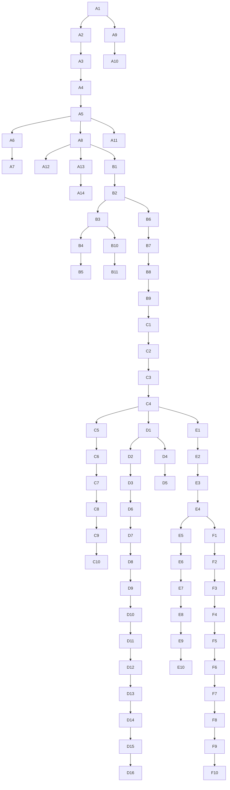

# Task Delta — Counter-only POS, Salespeople, Approvals, Pharmacist rule

Test-first, small, independently shippable tasks. Each row names the test that is written **before** the code, the requirement IDs it satisfies, and the observable verification. Waves A–F map to the phased releases recommended in **Q4**; A and B are prerequisites for everything after them.

Legend: **[NEW]** new file · **[REWRITE]** existing behaviour deliberately changed · **[RETIRE]** deleted path.

---

## Wave A — Counters and claiming (CR Part 1 → v2.2.0)

| # | Task | Req IDs | Test written first | Verification |
|---|---|---|---|---|
| A1 | `counters` schema: `unclaimed` default, `permission_profile(+version)`, `idle_lock_minutes`, `grace_hours`, rename `manager_pin`→`unlock_pin_hash(+attempts,+locked_until)`, `current_device_id`, `retired_at`, `last_salesperson_*` | CNT-001 | `IdentityScopeSchemaTest` [NEW] | Schema assertions; no till-facing route changes yet |
| A2 | Admin counter CRUD + delete-request (retire, never erase when documents exist) | CNT-002, CNT-009, CNT-010 | `CounterAdminCrudTest` [NEW] | Duplicate live name → 422 naming holder; deleting a counter with invoices retires it and history stays queryable |
| A3 | Per-counter activation codes: `counter_id`, hard single-use, owner TTL (default 24 h), hash-only, shown once, QR payload | CNT-003, CNT-004 | `ActivationCodeSingleUseTest` [NEW] | Second redeem → refused, identical message; code never present in any later response |
| A4 | Code issue / re-issue / revoke endpoints with rate-limit, lockout and owner alert | CNT-005, CNT-007 | [REWRITE] `DeviceActivationSecurityTest` + `ActivationCodeLockoutTest` [NEW] | Random/expired/reused/wrong-store code never activates; N failures → 429 + audit alert row |
| A5 | `POST /api/counters/claim` binds device→counter, enforces one active device, re-issue revokes the previous device | CNT-006, CNT-007 | `CounterClaimTest` + `CounterOneDeviceTest` [NEW] | Two devices, one counter: second refused `counter_already_claimed`; old device rejected after re-issue |
| A6 | Device token hash-only server-side; per-device token into the OS credential store (Q2) | CNT-006 | [REWRITE] `ipcBridge` tests + `PinSecrecyScanTest` [NEW] | No plaintext token in DB rows or in `.lamsuite_secure_vault.dat` |
| A7 | Setup screen becomes code/QR-only; store-key + owner-login tabs removed; keyboard-only | CNT-006, CNT-013 | `storeSetupClaim.dom.test.tsx` [NEW] | Fresh install reaches billing with code only; no credential fields present |
| A8 | `GET /api/counter/context`: counter + profile + defaults + grace + cached-credential manifest | CNT-011, PRF-001 | `CounterContextTest` [NEW] | Claim returns the same payload shape the boot path consumes |
| A9 | `counters:migrate-from-devices --dry-run/--rollback` + manifest; names, series and history preserved | CNT-012 | `CounterMigrationTest` [NEW] | Existing device rows become counters; issued numbers never reused; rollback restores |
| A10 | [RETIRE] `POST /devices/register-owner`, `POST /devices/register`, public `counters/enroll`, `approve-pairing`, `enrollment-status`, public `counters/{id}/status`; drop `stores.activation_key*` + `require_device_approval` | CNT-013 | `RetiredRegistrationPathsTest` [NEW] | Every retired route returns 410 with the "ask the owner for a counter code" message and **no token**; store key column gone; already-issued tokens keep working until next connection |
| A11 | Number series normalised: full doc-type set per counter, lease by counter id, `TEMP-*` never persists as a final number, till/backend key mismatch fixed | CNT-014 | [REWRITE] `documentSequenceSync.test.ts` + `CounterSequenceLeaseTest` [NEW] | Concurrent tills never collide; offline exhaustion reconciles on reconnect |
| A12 | Offline grace clock + revoked-counter-locks-offline | CNT-011 | `CounterGraceOfflineTest` [NEW] | Grace expiry locks the till locally; revocation observed on reconnect wipes the token and locks |
| A13 | One device holding one claimed counter per store; store switcher + isolated local data + per-store profile/token keys | CNT-008 | `CounterMultiStoreDeviceTest` [NEW] + till dom test | Two stores on one machine stay isolated; logging out of A cannot read B's counter |
| A14 | Admin panel `CountersPage` (create/edit/delete-request, codes + QR, lock/unlock/revoke/rename, status, active device, last activity, last salesperson, unsynced items) | CNT-009 | Live browser verification + `CountersPage.dom.test.tsx` [NEW] | Each action visible and audited without a reload |
| A15 | Counter code is numbered, not invented: the create dialog fills the store's next free code (and re-numbers when the store changes), and a blank code is numbered by the server | CNT-009 | `CounterAdminCrudTest` + `CountersPage.dom.test.tsx` | No admin types a code; per-store `C01, C02, …` never collides, and the issued code is in the audit |

**Debt booked by A6** (the vault in `credential_vault.rs` covers every key the till writes
through `secure_store_*`; the one remaining browser-storage token write is the staff
bearer token):

| Held | Where | Killed by |
|---|---|---|
| `localStorage.setItem("staff_token", …)` ×2 | [frontend/src/lib/auth/staffAuthService.ts](../../../frontend/src/lib/auth/staffAuthService.ts) (reads in `deviceSessionService`, `salesOrderService`, `loyaltyService`, `invoiceApprovalService`, `companySettingsService`, `userPreferencesService`) | **Cleared 2026-11-21 by B8b-4** — nothing writes or reads it, whatever an older build left is erased on boot and at logout, all six readers now send the counter's device token (and `userPreferencesService` stays local because `/api/me/preferences` answers only for a person). `PinSecrecyScanTest` pins the booked list as empty |

**Pulled forward out of order (decided 2026-11-21, because the till had no way to authorise
itself once the sign-in went):**

| # | Task | Req IDs | Test written first | Verification |
|---|---|---|---|---|
| A16a | The counter authorises the till routes that needed a person's token (`/store`, `/customers`, `/products`, `/purchases`, `/sales-orders`, `/loyalty/*`, `/coupons/*`, `/stock/*`, `/reports/*`, `/data-exchange/*`), always scoped to its own store | IS1, IS3 | `CounterAuthorisesPosRoutesTest` [NEW] (11 tests) | Done — see traceability Part 2 |
| A16b | The same for staff management at the till: six `/api/till/staff…` URIs under `device.auth` mapped to the existing `AdminUserController`, which is now safe with no person on the request, keeps the terminal rules, and audits the counter as the actor | IS1, IS3, IS5 | `TillStaffManagementTest` [NEW] (10 tests) | Done — the admin panel's `/api/admin/users*` is untouched and still person-only |
| B8a | Idle lock at the till + counter-PIN unlock screen | PRF-005 | `IdleLock.dom.test.tsx` [NEW] (11 tests) | Done |
| B8b | No sign-in at the POS: `SEC-001` retired, every till read of a signed-in person removed, credential storage cleared | SEC-001, IS5 | `signinRetired.test.ts` [NEW] (9 tests) + rewritten `userPreferencesService.dom.test.ts` (5) and `PinSecrecyScanTest` | Done — the dead sign-in machinery inside `staffAuthService` is booked for deletion with its four suites rewritten, not dropped |

## Wave B — Permission profile and locking (CR Part 2 → v2.2.0)

| # | Task | Req IDs | Test written first | Verification |
|---|---|---|---|---|
| B1 | Canonical profile JSON + versioning + `permission_profile_templates` + copy-from-counter | PRF-001, PRF-002 | `CounterProfileTemplateTest` [NEW] | Applying a template / copying a peer bumps version + audit diff |
| B2 | Action-key registry + `CounterProfilePolicy` + `counter.profile` middleware that **fails closed** | PRF-003 | `CounterProfileEnforcementTest` [NEW] | Unknown/undeclared action on a device route → 403 rather than pass-through |
| B3 | Declare and gate every device-scoped action (bill save, discount, price override, sell beyond stock, edit, cancel, return, purchase entry, stock adjust, transfer, reports, settings, salesperson manage, cash drawer) | PRF-001, PRF-003 | same suite, one test per action key | **Direct API calls** with a compliant payload are refused when outside the profile |
| B4 | Sync-ingest stance per Q1: accept queued offline docs, stamp profile version, flag violations into an exceptions register | PRF-003, Q1 | `SyncIngestProfileExceptionTest` [NEW] | A legitimately-offline bill is never lost; violations surface in admin |
| B5 | Profile propagation ≤ 5 s via heartbeat/SSE + till cache + offline last-saved | PRF-004 | `CounterProfilePropagationTest` [NEW] + till test | Admin saves → attached counter's next gated call fails within 5 s |
| B6 | `PinPolicy` service shared by all four PIN domains (length, trivial-value rejection, lockout, admin-only reset, never displayed) | PRF-006 | `PinPolicyTest` [NEW] | `0000`/`1234`/repeats rejected; 5 wrong → locked until owner reset |
| B7 | Counter unlock PIN set/reset from admin panel, cached locally in the vault, hashed server-side | PRF-006 | `CounterUnlockPinTest` [NEW] | No API returns the PIN or its hash in plaintext |
| B8 | Idle lock at the till + counter-PIN unlock screen (replaces staff lock/switch UX); retire the `staff_token` localStorage write booked under A6 | PRF-005 | `IdleLock.dom.test.tsx` [NEW] | N idle minutes → lock; counter PIN resumes the open cart; a staff/approver PIN is refused; `PinSecrecyScanTest` finds zero token writes in browser storage |
| B9 | Shifts re-keyed to counter, PIN-authenticated open/close; `counter_shifts.user_id` → `counter_id` (+ optional salesperson) | PRF-007 | [REWRITE] `DayCloseTest` + `CounterShiftTest` [NEW] | Shift totals reconcile to the paisa with no user identity |
| B10 | Profile change history view (before/after diff, actor, time) | PRF-008 | `ProfileAuditTrailTest` [NEW] | Diff present in the tamper-evident log |
| B11 | Till screens/menus derived from the profile (replacing `accessControl` role maps and `enabled_menus` at the counter) — hiding only | PRF-001, PRF-003 | till dom tests + [REWRITE] `reports/permissions` tests | Screens hidden match the profile; refusal proven server-side, not by UI |

## Wave C — Approvals (CR Part 3 → v2.3.0)

| # | Task | Req IDs | Test written first | Verification |
|---|---|---|---|---|
| C1 | `invoice_approvals` → `approvals` (widened action/document/counter/method/request-status + `rule_snapshot`), rows preserved | APR-007 | [REWRITE] `InvoiceApprovalTest` → `ApprovalRecordTest` | Six audit fields recorded for every method |
| C2 | Approver list per store (existing `users` managers/owners + `is_approver`, Q6) with personal PIN, policy, lockout, admin-only reset | APR-001, APR-002 | `ApproverPinTest` [NEW] | Cross-store approver id → 404; PIN never displayed |
| C3 | Approval rules per store and per counter (all eight triggers) with thresholds + `rule_snapshot` at grant time | APR-003 | `ApprovalRuleThresholdTest` [NEW] | Below threshold → no approval; above → required; per-counter override wins |
| C4 | `ApprovalService::assertSettled()` wired into invoice store/cancel/edit, returns, purchase entry, stock adjustments, large refunds, sell-beyond-stock, change-salesperson | APR-010 | `ApprovalEnforcementTest` [NEW] | **Direct** save of a discount-above-limit bill without a grant → 422 `approval_required` |
| C5 | Method 1 — approver PIN at the counter (online + cached-hash offline) | APR-004 | `ApproverPinAtCounterTest` + till test | Offline verification works from the vault with local lockout |
| C6 | Method 2 — one-time PIN bound to document+action, minutes TTL, single use, shown once | APR-005 | [EXTEND] `InvoiceApprovalTest` | PIN fails on any other document or action; second use refused |
| C7 | Method 3 — salesperson PIN for the owner-selected low-risk action set | APR-006 | `SalespersonPinApprovalTest` [NEW] | Action outside the selected set is refused |
| C8 | Shared `ApprovalDialog` on the billing screen + Past Bills; [RETIRE] the localStorage grant bypass | APR-010 | [REWRITE] `invoiceApprovalService.dom.test.ts` | A tampered/absent local grant cannot save a gated edit |
| C9 | Approvals inbox: request → remote grant → single redeem, expiry, SSE wake; pending blocks save (Q9) | APR-008 | `ApprovalInboxTest` [NEW] | Till request appears ≤ 5 s; grant redeems once; timeout expires and the bill stays unsaved |
| C10 | Anomaly alerts (same approver many bills, out-of-hours, repeat overrides) | APR-009 | `ApprovalAnomalyAlertTest` [NEW] | Configurable thresholds raise owner alert + audit row |

## Wave D — Salespeople (CR Part 4 → v2.3.0)

| # | Task | Req IDs | Test written first | Verification |
|---|---|---|---|---|
| D1 | `salespeople` table + store scope + unique in-store code + archive-not-delete + `version` | SPR-001, SPR-003, IS1, IS4 | `SalespersonMasterStoreScopeTest` [NEW] | Duplicate code 422 in-store / allowed cross-store; deleting a person with bills archives |
| D2 | Admin API + `SalespeoplePage` (CRUD, photo, allowed counters, active/inactive, dates, target) | SPR-001, SPR-002, SPR-005 | `SalespersonAdminTest` [NEW] | 409 on version conflict; audit diffs recorded |
| D3 | `staff:convert-to-salespeople` migration (PIN hashes carried so credentials survive as approver/pharmacist evidence) | CNT-012, SPR-001 | `StaffToSalespersonMigrationTest` [NEW] | Managers become salespeople **and** approvers; no till can log in as them |
| D4 | Incentive rules (pct net sales before tax, pct by group, pct by brand, target) with effective dates + engine | SPR-014 | `SalespersonIncentiveEngineTest` [NEW] | Statement equals Σ(net taxable × rate) to the paisa against raw lines (paisa oracle) |
| D5 | Monthly statement per salesperson + export | SPR-014 | `IncentiveStatementTest` [NEW] | Export matches the on-screen statement exactly |
| D6 | Store settings: `salesperson_on_bill` (default **required**), per-line toggle (off), default choice (last used/none), after-save change needs approval | SPR-006…SPR-009 | `SalespersonBillSettingsTest` [NEW] | Required + empty blocks save online **and** offline; change-after-save without a grant → 422 |
| D7 | Till cache + `GET /api/salespeople/eligible?counter_id=` + local SQLite v9 `salespeople` + store purge | SPR-010, IS9 | `SalespersonOfflineListTest` [NEW] | Offline bills pick from the cached list; allowed-counter filter respected; disconnect purges |
| D8 | POS bill-header type-ahead + keyboard shortcut from the central map + hint-strip entry + remembered value + id/name snapshot | SPR-010 | `salespersonCombobox.dom.test.tsx` [NEW] + [REWRITE] `publishedKeyMap.test.ts` | Fully keyboard-only: shortcut → type → Enter → save; rename later never rewrites history |
| D9 | Persist snapshot columns on `invoices` (+ local) and stamp them through the invoice payload; [RETIRE] writing `invoices.user_id` from the till | SPR-010 | `InvoiceSalespersonStampingTest` [NEW] | Synced rows carry id + name-at-time; no till bill has a user id |
| D10 | Optional per-line salesperson cell in the entry row + `invoice_items` columns | SPR-007, SPR-011 | `salespersonPerLine.dom.test.tsx` [NEW] | Off → nothing stored; on → line-level snapshot reported |
| D11 | Returns inherit the original salesperson and reverse incentive proportionally; cancellations reverse fully; edits keep history | SPR-012, RET-001 | `SalespersonReturnReversalTest` [NEW] | Half-quantity return reverses half the incentive; cancel reverses 100 % |
| D12 | Print the salesperson through the field panel (lights up the declared-but-dead `salesman` field), off by default | SPR-013 | [REWRITE] print preview field tests + `printingEngine` snapshots | Thermal/A4/dot-matrix render it when enabled; default bills byte-identical |
| D13 | Reports: sales, returns, discounts, average bill, items, incentive by salesperson; target vs achievement | SPR-015 | `SalespersonReportTest` [NEW] | Figures reconcile to the paisa oracle; per-store only |
| D14 | Live dashboard: sales per salesperson today + anomaly flags (unusual discounts/cancellations/returns) | SPR-016 | `SalespersonLiveTileTest` [NEW] | Dashboard equals the report for the same window |
| D15 | Counter-side salesperson management gated by profile + full audit | SPR-018 | `SalespersonAtCounterTest` [NEW] | Profile without the right creates a 403 even via direct call |
| D16 | Spreadsheet import/export, store-targeted, duplicate/cross-store rejected | SPR-004, R10 parity | `SalespersonDataExchangeTest` [NEW] | Import names the target store on confirm; export is store-filtered |

## Wave E — Pharmacist rule (CR Part 5 → v2.4.0)

| # | Task | Req IDs | Test written first | Verification |
|---|---|---|---|---|
| E1 | Drug-schedule list (`master_lookups.type='drug_schedule'`, `is_restricted`, `requires_prescription`) + `products` columns denormalised at save + item-master UI (pharmacy only) + sync/import/export | PHR-001, MST-001 | `DrugScheduleStoreScopeTest` [NEW] | Editing the list changes what counts as restricted on **new** bills; history keeps the flag as sold; dead `schedule_type` data path becomes real |
| E2 | Pharmacist fields on `salespeople` (`is_pharmacist`, `reg_no`, `reg_valid_from/until`) + PIN domain + policy | PHR-002, PHR-008 | `PharmacistRecordTest` [NEW] | Same PIN as an approver/counter PIN is rejected; pharmacist is not a login |
| E3 | `RestrictedDrugResolver` + server gate on save/return/cancel when a restricted line lacks a pharmacist confirmation | PHR-004 | `PharmacistGateTest` [NEW] | Bill, its return and its cancel are each refused without a valid pharmacist PIN, including direct API calls |
| E4 | Confirmation dialog listing the restricted items; `pharmacist_confirmations` rows + invoice snapshot columns (id, name, reg, time) | PHR-004, PHR-005 | `PharmacistConfirmationTest` [NEW] | Bill detail, register and exports show all four fields; snapshot survives later edits |
| E5 | Prescription validity per schedule + persist `prescription_no`, `doctor_id`, `patient_id` (POS-007) | PHR-006 | `PrescriptionRequiredByScheduleTest` [NEW] | Missing doctor on a prescription-requiring schedule blocks save; others unaffected |
| E6 | Real restricted-drug registers: filter by schedule (replaces "every invoice" / "latest 50 with doctor_name") + controlled-substance register | PHR-006 | [REWRITE] `schedule-h-register` + `AdminReportController` tests | Register lists only restricted-drug bills, with pharmacist columns |
| E7 | Offline: cached-hash verification + local lockout + confirmation queued with the bill + revocations applied on reconnect + admin shows offline confirmations | PHR-009 | `PharmacistOfflineConfirmationTest` [NEW] | Offline save succeeds, queues, syncs; revoked pharmacist's offline confirmation appears as an exception, never silently discarded |
| E8 | Wrong-PIN lockout + alert + admin-only unlock | PHR-007 | `PharmacistLockoutTest` [NEW] | 5 failures → locked + owner alert; no counter-side unlock exists |
| E9 | Pharmacy-only isolation: schedule list, pharmacist fields, registers, print block absent for non-pharmacy stores in screens, API, reports and print | PHR-011, IS8 | `PharmacyOnlyLeakTest` [NEW] (constitution CI) | Zero leakage on any of the four surfaces |
| E10 | Admin pages: pharmacist list, registration-expiry alerts, restricted-drug bills by pharmacist/counter/day, exceptions report | PHR-010 | `PharmacistAdminTest` [NEW] | Expiry alert inside the configurable window; exceptions report includes offline + revoked cases |

## Wave F — Monitoring, documents, release (CR Part 6 → v2.4.0)

| # | Task | Req IDs | Test written first | Verification |
|---|---|---|---|---|
| F1 | Counter-centric live view (status, last-bill salesperson, bills per salesperson, approvals used, restricted-drug confirmations, offline periods, unsynced items) on `device_sessions` reworked + `DevicesPage`→`CountersPage` | MON-001 | [REWRITE] `LoggedInDevicesTest` | Every tile matches the underlying rows |
| F2 | [RETIRE] POS-side "signed-in user" + one-active-session-per-user; keep admin-panel session policy and impersonation | MON-002 | `SessionPolicyRetirementTest` [NEW] | Till sessions carry no user; admin-panel session tests still pass |
| F3 | Constitution: add `P-IDENTITY-SCOPE` IS1–IS10 + CI guards; update the shared-vs-scoped table | IS1…IS10 | `IdentityScopeSchemaTest`, `CounterClaimIsolationTest`, `PinSecrecyScanTest`, `PharmacyOnlyLeakTest` | Constitution CI suite green; R1–R11 untouched |
| F4 | Spec files: 6 new module specs + amendments to SEC/CFG/MST/POS/RET/REP + `01-overview` taxonomy/personas | all | doc review | Every new ID has a spec home and a traceability row |
| F5 | `specs/traceability.md`: 63 new rows + changed/retired rows with implementation + verification test | all | doc review | No ID without a test, no test without an ID |
| F6 | `specs/02-plan.md` §3 (local SQLite v9) + §5 (counter-scoped security) rewritten | CNT/PRF/SPR/PHR | doc review | Plan matches shipped schema |
| F7 | `specs/api/openapi.yaml`: all new routes documented (today it has 15 paths and none of the counter/approval family), 6 retired routes removed, gates documented | all | contract test | Every POS action has a documented endpoint (100 % API parity goal) |
| F8 | `keyboard-shortcuts.json` + `docs/KEYBOARD_SHORTCUTS.md` + `SCREENS_PERMISSIONS_MATRIX.md` + `docs/REMOTE_COUNTER_SETUP_GUIDE.md` | SPR-010, CNT-006 | `publishedKeyMap.test.ts` | Published map equals code; setup guide has no pairing-code/owner-login steps |
| F9 | `CHANGELOG.md` unreleased entry listing every added/changed/retired ID | all | doc review | Change log matches the delta |
| F10 | Release staging + live QA: counter claim, profile refusal, approval each method, salesperson keyboard-only billing, pharmacist rule, cross-store isolation — with money reconciled to the paisa | all | manual + scripted | Verification report, **no token-bearing artifacts committed** |

## Dependency order

## Sizing (for planning, not a promise)

| Wave | Tasks | Rough effort | Ships as |
|---|---|---|---|
| A — Counters & claiming | 14 | 8–11 dev-days | v2.2.0 |
| B — Profile & locking | 11 | 6–8 dev-days | v2.2.0 |
| C — Approvals | 10 | 5–7 dev-days | v2.3.0 |
| D — Salespeople | 16 | 8–11 dev-days | v2.3.0 |
| E — Pharmacist rule | 10 | 6–9 dev-days | v2.4.0 |
| F — Monitoring, docs, release | 10 | 4–6 dev-days | each wave + v2.4.0 |

**Definition of done per task:** the named test exists and fails before the change and passes after; the requirement ID is in `traceability.md` with the test file recorded; any retired path returns a documented refusal rather than a silent 404; no new PIN/token material appears in responses, logs, exports or print; store isolation tests pass for a second store; `backend/tests/Feature/Constitution/` stays green.
