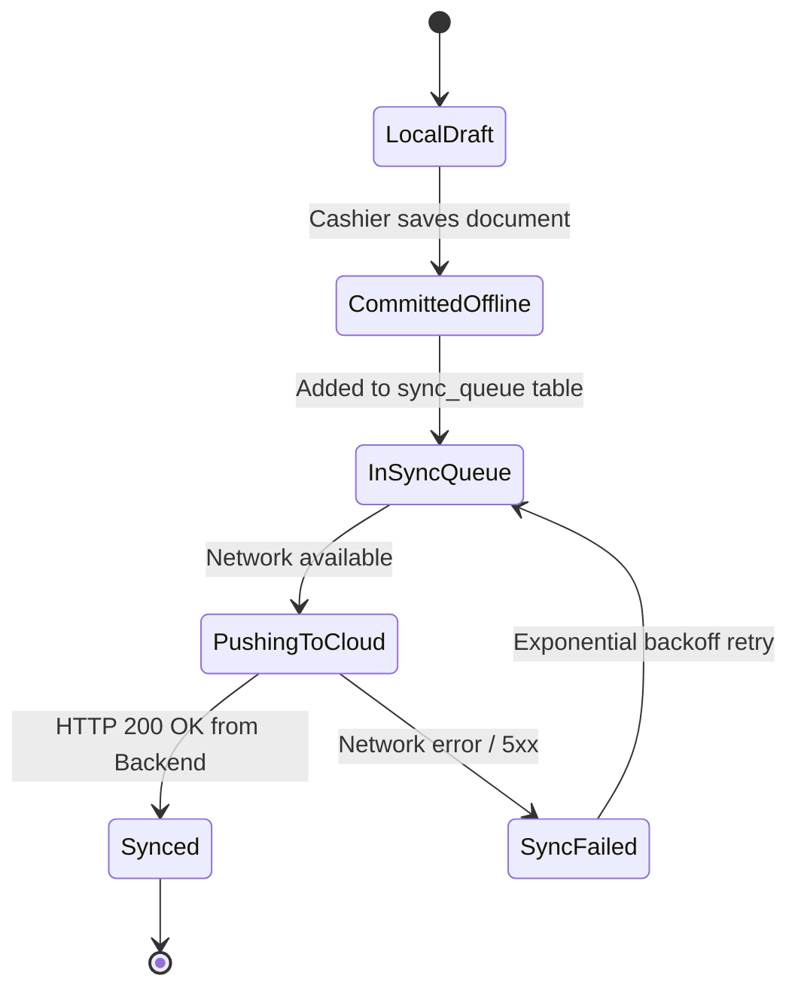

# Module Spec: Sync, Offline-First & LAN Sharing (SYNC)

## 1. Overview
The synchronization engine powers resilient offline-first multi-terminal retail operations. It combines local ACID SQLite storage, an asynchronous idempotent sync queue, cloud delta reconciliation, and local in-store peer-to-peer LAN master data sharing.

---

## 2. Requirement Specifications & Acceptance Criteria

### [SYNC-001] Offline-First Local Database Architecture
- **Story:** As a store cashier, I must be able to ring up bills, print receipts, and check inventory without an active internet connection.
- **Acceptance Criteria:**
  - **Given** an offline workstation (no WAN connection),
  - **When** the cashier operates the POS, creates products, records purchases, or views reports,
  - **Then** all reads and writes execute against local SQLite in `< 10ms`.
  - **When** network connectivity drops during active billing,
  - **Then** the application continues without freezing, modal errors, or dropped data.

### [SYNC-002] Asynchronous Sync Queue & Idempotency
- **Story:** As a system administrator, I want offline transactions queued locally and safely synced to the cloud when internet returns without duplicate records.
- **Acceptance Criteria:**
  - **Given** 100 invoices saved offline,
  - **When** internet connectivity is restored,
  - **Then** the background sync engine pushes pending records in batches to the backend `/api/sync/*` endpoints.
  - **When** a batch is retried due to temporary network timeout,
  - **Then** the backend uses the unique `external_id` (UUID) to ensure zero duplicate records are inserted (`ON DUPLICATE KEY UPDATE` / idempotent insert).
  - **When** the backend acknowledges the sync,
  - **Then** the local sync queue marks records as `synced` and records `last_synced_at`.

### [SYNC-003] Cloud Master Delta Pull
- **Story:** As a store owner updating prices on the central cloud admin, I want all store terminals to receive updated product catalogs and prices automatically.
- **Acceptance Criteria:**
  - **Given** changes made to central catalog or customer records,
  - **When** the desktop app performs its periodic delta sync (or upon manual sync request),
  - **Then** it requests updates since `last_sync_watermark`.
  - **When** changes are received,
  - **Then** local SQLite is updated within a single transaction, refreshing POS catalog search immediately.

### [SYNC-004] Stock Event Stream Synchronization
- **Story:** As a multi-store owner, I want central headquarters to receive an accurate audit stream of all inventory movements.
- **Acceptance Criteria:**
  - **Given** local sales, purchases, or adjustments,
  - **When** syncing stock events,
  - **Then** events are streamed sequentially with sequence counters:
    `[event_id, store_id, product_id, batch_id, event_type, delta, timestamp]`.
  - **When** received at central,
  - **Then** central validates sequence continuity and updates cloud store stock ledgers.

### [SYNC-005] In-Store LAN Peer Discovery & Master Snapshot Sync
- **Story:** As a pharmacy with 3 billing counters on the same local network, I want Secondary Counter 2 and 3 to discover the Main Store Server on the LAN and sync master data even when the store's broadband internet is down.
- **Acceptance Criteria:**
  - **Given** multiple desktop terminals on the same local Wi-Fi or Ethernet router,
  - **When** terminal boots up,
  - **Then** it broadcasts/listens via UDP / mDNS (multicast DNS) on a fixed port to discover the Main Store Station.
  - **When** connected,
  - **Then** secondary counters can pull latest catalog items, customer balances, and batch quantities directly over LAN HTTP (`http://<main-station-ip>:<lan-port>/lan/v1/pull`).

### [SYNC-006] Scheduled Database Backup & Disaster Recovery
- **Story:** As a store owner, I want automated daily local database backups and easy one-click restore to protect against hardware failure.
- **Acceptance Criteria:**
  - **Given** daily operations,
  - **When** the scheduled backup time arrives (or user clicks "Backup Now"),
  - **Then** an encrypted, compressed snapshot of the SQLite database (`.bak` or `.sqlite.gz`) is saved to a designated backup directory or external USB drive.
  - **When** restoring on a replacement computer,
  - **Then** selecting the backup file validates schema integrity, restores all local tables, and reconnects to cloud sync seamlessly.

---

## 3. Sync State Machine

